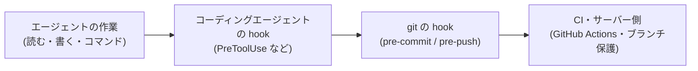

# 検査をどこに置くか (コーディングエージェントの hook / commit・push の hook / CI)

mid-harness が配る `scripts/agent-hooks/pre-tool-policy.sh` は**サンプル**で、既定では何も止めない (受け入れテスト用の番兵だけが、`MID_HARNESS_HOOK_LOG` があるときに働く)。
検査を足す前に、その検査をどこに置くべきかをこの資料で決める。

## 置き場所は 3 つ



| 置き場所 | 見られるもの | 外し方 | 向いている検査 |
|---|---|---|---|
| コーディングエージェントの hook | ツール名と入力 (コマンド文字列、ファイルパス) | 製品の trust 設定、hook のエラーを fail-open に扱う製品もある | うっかりを早く止める抑止。判定材料が構造化されているもの (Edit / Write のパスなど) |
| git の hook | コミットされる差分の中身、push 先の ref | `git commit --no-verify` など、わざわざ操作が要る | 中身で判定できるもの (秘密情報など) |
| CI・サーバー側 | push された内容そのもの | 手元からは外せない。ただしマージを止めるには、ブランチ保護で必須チェックに指定する必要がある | 必ず守りたいもの。手元で外された検査の取りこぼしを拾う最後の関門 |

CI は push の**後**に走る。秘密情報のように「リモートに出た時点で手遅れ」のものは、CI だけでは防げない (検知はできるが、履歴に残った後なので資格情報の失効と履歴の消去が要る)。
出る前に止めるのは git の hook の役目で、CI は「git の hook を外された・入れ忘れた」ときの検知と、main へのマージ阻止を受け持つ。

## 確実に効く検査の条件

次の 4 つを満たすものだけが「絶対に通さない」検査になる。満たさないものは抑止と割り切る。

| 条件 | 満たす例 | 満たさない例 |
|---|---|---|
| 結果 (中身・パス・送り先) で判定する | gitleaks は、コミットされる差分の中身を見る | コマンド文字列から「取得して実行するか」を読み取る |
| 書き方を変えても逃げられない | 差分の中身が同じなら、どんなコミットのしかたでも引っかかる | シェルの書き方は無数にある (`curl … \| sh` の変形は、自動の検査が修正のたびに新しく見つけた。経緯は `recovery.md`) |
| 抜けるにはわざわざ操作が要る | `--no-verify` を付ける。CI ではそもそも外せない | 普通の書き方の範囲で抜けられる |
| 誤検知を許可リストで逃がせる | gitleaks の allowlist で逃がせる | 規則が複雑になり、狙った箇所だけ逃がせない |

コーディングエージェントの hook でシェルのコマンド文字列を解析する検査は、上の 2 つ目を満たせない。
足しても「明らかな形を止める抑止」にしかならないので、規則を複雑にしてまで変形を追いかけない。

## 何をどこに置くか (例)

| 守りたいこと | コーディングエージェントの hook | git の hook | CI・サーバー側 |
|---|---|---|---|
| 秘密情報をコミットしない | 置かない (Bash 経由の書き込みは見えない) | gitleaks (pre-commit)。ここが出る前に止める本命 | gitleaks (Actions) を必須チェックにする。push 後の検知とマージ阻止 |
| main を壊さない (force push・直接 push) | 抑止として置いてよい (サンプルの例 3) | pre-push で push 先の ref を見る | ブランチ保護 |
| 秘密ファイル (`.env` など) を読み書きしない | Read / Edit / Write のパスで判定する。製品の拒否設定 (Claude Code の permissions など) も併用する | 置かない | 置けない (読んだ事実や、秘密の文字列を含まない書き込みは CI から見えない)。中身の秘密情報が出ていくのは上の行の gitleaks で止める |
| ハーネス自体 (hook・設定) を書き換えない | Edit / Write のパスで判定する | 置かない | `check_drift.py` を CI で回す |
| 取得したものをそのまま実行しない | 抑止として置いてよい (サンプルの例 2) | 置けない | 置けない。確実に止めるなら、サンドボックスでネットワークの通信先を絞る |

gitleaks を pre-commit framework で入れる場合の設定 (`.pre-commit-config.yaml`。`rev` は導入時の最新版に合わせ、`pre-commit install` で有効にする):

```yaml
repos:
  - repo: https://github.com/gitleaks/gitleaks
    rev: v8.24.2
    hooks:
      - id: gitleaks
```

CI では gitleaks-action (https://github.com/gitleaks/gitleaks-action) を使い、ブランチ保護の必須チェックに指定する。どちらも、使う時点の公式 README で設定を確かめてから入れる。

## サンプル hook に検査を足すとき

1. 上の表で、その検査がコーディングエージェントの hook に置くべきものかを確かめる
2. `pre-tool-policy.sh` 末尾のコメントアウトした例を参考に書く。拒否は `deny <理由コード> <メッセージ>` を呼ぶ (6 製品分の拒否形式を出して exit 2 する)
3. `scripts/hook-fixtures/` に `deny-` と `allow-` の fixture を足し、`scripts/test_hook.sh <hook>` で確かめる
4. 迷う形は止める側に倒してよいが、変形を追いかけて規則を複雑にしない。抜けた形は「既知の限界」として記録する
