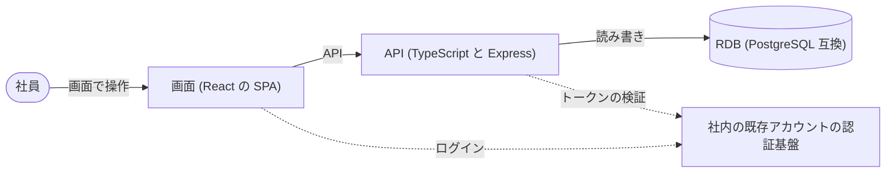

# 決定の段の確認材料 (会議室予約システム)

要求 (社員が会議室の空きを見て予約し、本人が取り消す) から、守る水準 (非機能のグレード) と作り方の決定を推奨案で決めた。人に確かめてほしいことは最後の節にまとめた。

- 最初の決定の段で 12 件を決め、その後の決定の差分で 11 件を足した (うち 5 件は前の決定を置き換えた)。今有効な決定は 18 件。
- この要約は決定の差分のたびに追記する。食い違いがあれば [ADR の一覧](index.md)・各 ADR・[非機能要求グレード表](../nfr/nfr-grade.md) を正とする。

## 守る水準のハイライト

社内の数十人が使い、社外への影響が無いので、いちばん控えめな水準 (社会的影響が極めて限定的なシステム) にした。

| 観点 | 決めた水準 | 根拠 | 確かさ |
|---|---|---|---|
| 同時に使う人数 | 100 人以下 | 要望に利用者は数十人 | 高 |
| 画面の応答 | 5 秒以内 | 画面で操作する UC が中心 | 中 |
| 稼働を保証する時間 | 平日の定時内 (9 時〜17 時) | 夜間・24 時間の記述が無い | **低 (仮置き)** |
| 止まったときの冗長化 | しない (再起動で復旧) | 外部システムは社内の認証基盤 1 つ (サインインとトークンの発行だけ)。認証基盤が止まればサーバを冗長化しても使えず、利用者は社内の数十人 | 中 |
| データを戻せる地点 | 障害の直前まで (差分で前日から引き上げた) | 前日まで戻すと、障害の日に成立を知らせた予約が消え、その枠を別の社員が予約できて二重予約の防止が破れる | 中 |
| バックアップの仕方 | 定期の全体バックアップ + 更新の記録を別の保管場所へ同期して書く (差分で毎日から引き上げた) | 戻せる地点を障害の直前にしたため。毎日のバックアップではその日の予約が消える | 中 |
| ログを残す期間 | 3 ヶ月 | 一般業務の目安 | **低 (仮置き)** |
| 今の表計算ファイルからの切り替え | 一括で切り替え、先の予約は社員が予約し直す | 5 部屋の小規模 | **低 (仮置き)** |
| ログインの強さ | 社内の既存アカウントに従う (パスワードを持たない) | 要求の段の仮置き | **低 (仮置き)** |
| 対応するブラウザ | 主要なブラウザ 2〜3 種 (PC) | スマートフォンの記述が無い | **低 (仮置き)** |
| 使う端末 | PC のブラウザだけ (スマートフォン向けの画面は作らない) | 要望は「Web 画面」とだけ書く | **低 (仮置き)** |
| 権限の制御 | 予約者本人だけが取り消せる | 取り消しの条件 | 高 |
| 保存データの暗号化 | しない | 氏名・連絡先・金銭を持たない | 中 |

全 97 項目の表は [非機能要求グレード表](../nfr/nfr-grade.md)。

## 作り方の決定 (決めたことと選ばなかった案)

| 決めたこと | 選ばなかった案と理由 |
|---|---|
| 画面と API の 2 つに分け、両方 TypeScript で作る。API は 1 つのまとまり。**画面は実績のある OIDC の部品で社内の認証基盤へサインインし、トークンは「API 呼び出し」の層の 1 か所で付ける**。テストではこの 1 か所を差し替えて社員を切り替える (差分で最初の決定を置き換えた) | 定期処理の担当を置く (仕事が無い) / API を業務ごとに分ける (業務が 1 つ) / 入口の門番 (社外の利用者が居ない) / サインインの流れを自前で書く (安全性の保守を自前で持つ) / トークンを画面ごとに付ける (UC ごとに方式がばらつく) |
| API の中を 5 つの層に分け、業務のルールを最も内側に置く。画面は「画面」と「API 呼び出し」の 2 層。**層の依存は許可する 6 方向だけにし、残る 14 方向はすべて機械で禁止する**。外部とのやり取りの層はどの層も読まない (差分で最初の決定を置き換えた) | 3 層・2 層 (二重予約の決まりの置き場がぼやける) / 足りない禁止だけを別に足す (最初の決定の文と、エラーの変換の決定との食い違いが残る) |
| データは RDB 1 つ。会議室 5 部屋は初期データで入れる | キャッシュや検索の仕組みを足す (要らない) |
| **二重予約は DB が防ぐ**。予約が占める 30 分の枠を 1 行ずつ書き、「会議室 × 枠の開始」が重複しない制約を付ける。同時に予約しても後の 1 件は「重なる」で失敗する | アプリで確かめてから書く (確かめた直後に別の予約が入りうる) / 時間の範囲の重なりを禁じる制約 (テスト用の DB で使えるか未確認の拡張が要る) |
| 予約は「予約した」「取り消した」の記録を消さずに足していく。今の状態は別の表に持つ | 上書きだけ (取り消した人と時刻が残らない) / 記録から毎回状態を計算する (手間に見合わない) |
| (後の差分「同じ内容の送り直しは成立済みの予約を返す」に置き換え、決定はそちらに引き継いだ) 通知や非同期の仕組みは使わない。すべてその場で結果を返す | 非同期で予約を処理する (成否をすぐ返す必要がある) |
| ログインは社内の既存アカウントに任せる。取り消しと一覧は「予約者が本人か」で判定する | 専用の ID とパスワード (管理の責任が増える) / ロールによる権限 (ロールが無い) |
| テストは 4 段。受入は API で確かめ、ブラウザでは回さない。現在時刻は固定の時計で決める | ブラウザでも受入を回す (遅く、得るものが少ない) |
| 画面は単一の React の SPA。共通の部品とデザイントークンを持つ | 画面ごとに直接書く (同じ表示が複数の画面に出る) |
| 業務のルールは「予約」のまとまりと「時間帯」の値で守る。現在時刻は外から渡す | 手続きの中に条件を書く (散って確かめにくい) |
| (後の差分「重なるのエラーは API の手続きの層の 1 か所で作る」に置き換え、決定はそちらに引き継いだ) 業務のエラーは理由のコードで返し、画面が理由の文を出す (重なる・30 分刻みでない・取り消せない など) | すべて同じエラーで返す (理由を出し分けられない) |
| ログは JSON の 1 行。業務の出来事を残し、トークンや本文は出さない | テキストのログ (検索しにくい) |
| 機械チェックは既定の道具で 6 観点 (生成物・整形・静的検査・ビルド・テスト・セキュリティ) | 別の道具に替える (既定と二重になる) |
| (差分で追加) API に送るのは認証基盤が発行するアクセストークン (JWT)。API は署名・発行者・宛先・期限を確かめ、社員はトークンの持ち主の識別子で決める | 本人確認のトークンを API に送る (API 向けの使い方ではない) / 毎回認証基盤に問い合わせる (呼び出しが増える) / 宛先を確かめない (別のシステム向けのトークンで呼べてしまう) |
| (差分で追加) DB は障害の直前まで戻せるようにする。更新の記録を別の保管場所へ書き終えてから予約の成立と取り消しを確定し、応答する。復旧では予約と枠の占有を同じ時点へ戻し、再開前に一致を確かめる | 前日のバックアップまで戻す (成立を知らせた予約が消え、二重予約が起きうる) / バックアップの間隔を縮める (間隔の分だけ消える) / 更新の記録を後から送る (送る前に DB を失うと消える) |
| (差分で追加) 時間帯は開始の日付 (日本時間) の 0:00 から翌日 0:00 までに収める。終了の 24:00 は翌日 0:00 の日時で持つ。日をまたぐ時間帯は「時間帯が正しくない」(逆転・同じ時刻と同じ理由) で受け付けない。過去でないことの確認は予約のときだけ | 日をまたぐ時間帯に別の理由のコードを作る (画面の文を分ける理由が無い) / 日付を時間帯と別に受ける (2 か所の日付が食い違いうる) / 「24:00」の表記で持つ (日時として扱えない) |
| (差分で追加。後の差分「画面の間で選んだ値はクエリで渡す」に置き換え、決定はそちらに引き継いだ) 画面と API は同じオリジンで配信し、画面は /api の相対パスで呼ぶ (API に CORS を入れない)。開発時は画面の開発サーバが /api を API へ中継する。サインイン後は /auth/callback の 1 画面で受け、サインイン前に開いていた画面へ戻す (戻すのは画面だけで、入力中の値は入れ直す)。予約の取消の画面のような、予約の番号を含む画面の住所も照合し、番号を画面に渡す。認証基盤の設定は 4 つの環境変数で渡す。テスト用のトークンは「Bearer 」を付けない値で返し、付けるのは API を呼ぶ 1 か所だけ | 画面と API を別のオリジンに置く (CORS の設定と事前の確認の要求が増える) / 開発時だけ CORS を許す (開発と本番で呼び方が変わる) / サインイン後は常に先頭の画面へ戻す (開いていた画面を失う) / 入力中の値も保存して戻す (画面ごとに保存と後始末が要る) / 画面が住所から番号を自分で読む (読み方が画面ごとに散らばる) / 設定を API から取る (サインイン前に API を呼ぶ順番の問題) |
| (差分で追加) 画面はトークンをメモリだけに持ち、ブラウザの保存場所に書かない。期限の 60 秒前を過ぎたら、更新用のトークン (リフレッシュトークン) で画面の裏で更新する。更新できなければサインインへ戻す。画面を読み込み直したときもサインインへ戻す (認証基盤のサインインが残っていれば入力は要らない)。API に付けるトークンは本番もテストも「Bearer 」の無い値で受け渡し、付けるのは API を呼ぶ 1 か所だけと言い切る。本番の配信は、ファイルの無い画面の住所 (サインインの戻り先 /auth/callback など) にも画面の入口を返す | ブラウザのタブの保存場所 (sessionStorage) に置く (画面に入った不正なスクリプトに読まれる) / ブラウザの長く残る保存場所 (localStorage) に置く (タブを閉じても残る) / 部品の自動更新を既定のまま使う (隠した画面 (iframe) がサインインの戻り先を開いてしまう) / 更新しない (期限ごとに認証基盤へ移り、入力中の値を失う) / トークンを持つ中継のサーバを足す (ティアが増える) |
| (差分で追加) 認証基盤がトークンの期限を返さないときは、期限が近くないものとしてそのまま使う。期限が切れていれば API が「認証されていない」(401) を返し、画面はいつもの扱いでサインインへ戻す (入力中の値は入れ直す) | 使う前に毎回更新する (呼ぶたびに往復が増え、更新用のトークンが無いとサインインへ戻り続ける) / 画面がトークンの中身から期限を読む (API の役割と重なる) / 決まった長さの期限を仮に置く (認証基盤の設定と合わない) |
| (差分で追加) 画面の間で選んだ値 (空き状況で選んだ会議室と日付・時間帯) は、移る先の画面の住所の「?」の後ろ (クエリ) に入れて渡す。画面の入口がクエリを読んで画面に渡し、画面は値を入力の初期値としてだけ使う (欠けた値や形の合わない値は空のままにして入力してもらう)。サインインの往復の後も引き継いだ値は残る (入力中に変えた値は残らない)。上の「画面と API は同じオリジンで配信」の決定を置き換えて引き継ぎ、画面の入口が画面に値を渡す形 (住所の番号とクエリの 2 つを渡す形) を 1 つにまとめた | 前の決定を残したまま渡す形だけ上書きする (渡す形の決まりが 2 つ並び、どちらに従うかで型の検査の結果が変わる) / ブラウザの履歴に値を持たせる (サインインの往復や読み込み直しで消える) / ブラウザの保存場所に置く (保存と後始末が画面ごとに要る) / 画面どうしで共有するメモリに置く (読み込み直しで消える) / 画面が住所を自分で読む (読み方が画面ごとに散らばる) / 形の合わない値でエラーを出す (入力すれば済む) |
| (差分で追加) 通知や非同期の仕組みは使わず、すべてその場で結果を返す (上の決定を置き換えて引き継いだ)。二重の送信を防ぐ専用の鍵 (冪等キー) は入れない。応答が届かずに同じ内容 (本人・会議室・時間帯がすべて同じ) を送り直したときは、新しい予約を作らず成立済みの予約を「成立した」として返す。それ以外の重複は「重なる」で断る。送り直しは鍵ではなく予約の内容で見分ける。送り直しかどうかは「過去の時間帯」の確認より先に見るので、開始時刻を過ぎてから送り直しても成立済みの予約が返る (時間帯の形の確認だけはその前に行う)。前の決定の「二重に送った予約は重なるエラーになる」は要求と食い違うので消した | 前の決定を残して理由だけ補う (「重なるエラーになる」の文が有効なまま残る) / 冪等キーを入れる (予約の内容で見分けられ、鍵の保存と後始末が増えるだけ) / 過去の時間帯を確かめてから送り直しを探す (開始後の送り直しが「過去の時間帯」で断られる) |
| (差分で追加) 業務のエラーは理由のコードで返し、画面が理由の文を出す (上の決定を置き換えて引き継いだ)。同時の予約で DB が枠の重複を弾いたときは、DB を読み書きする層は「重なり」を値で返すだけにし、「時間帯が重なる」のエラーは手続きの層 (usecase) が作る。事前の重なりの確認で見つけたときも同じ層で作るので、重なるのエラーを作る場所は 1 か所になる。今の実装の形に決定を合わせた (実装は変えない) | DB を読み書きする層で重なるのエラーを作る (作る場所が 2 か所に分かれる) / DB の失敗を例外のまま手続きの層で捕まえて変える (業務の結果を例外で運ぶことになり、戻り値で返す決定と合わない) / 前の決定を残して 1 本だけ補う (食い違う 2 つの決まりが並ぶ) |

日時は UTC で保存し、日付と 30 分刻みは日本時間 (Asia/Tokyo) で判定する。

## ブランド方針の由来

ブランドの道具を試したが、このリポジトリにブランドの指針の文書が無かったため、**要求から推論した** (確かさ: 低)。

| 項目 | 推論した値 |
|---|---|
| 主色 | #1D4ED8 (青) |
| 補助色 | #0F766E (緑寄りの青。「空き」の表示) |
| 強調色 | #F59E0B (橙。注意) |
| 中立色 | #64748B (灰) |
| 文字 | 見出し・本文とも Noto Sans JP |
| 印象 | 分かりやすい・落ち着いた・迷わない |

## 確認してほしいこと

1. **社内のアカウントのつなぎ方**: 社内の既存アカウントで、OpenID Connect (OIDC) によるログインを使えるか。使えなければログインの方式を決め直す。
2. **稼働を保証する時間**: 平日の定時内だけ保証すればよいか (時間外は止まっていてもよいか)。
3. **今の表計算ファイルの予約**: 切り替えの時点で残っている先の予約は、社員に予約し直してもらう案でよいか。この案には、予約し直しが済んだことを確かめる手順が無い。予約し直されていない予約があると、その時間帯が新しいシステムでは空きと表示され、別の社員が予約できる (二重予約になる)。確かめるなら、切り替え前に表計算ファイルを更新禁止にし、先の予約が新しいシステムにすべてあることを照合してから使い始める。
4. **ブランドの色と文字**: 上の推論した色と文字でよいか。会社の決まった色があれば差し替える。
5. **画面の確認の仕方**: 受入をブラウザで回さず、API と画面部品の確認で済ませてよいか。この場合、画面と API のつなぎ違い (ボタンが API を呼ばない など) は受入では見つからず、画面の入口関数のテストと画面部品の確認に任せる。ブラウザでも回すなら、テストの実行環境を作り直す (基盤の段に戻る)。
6. **業務の時間帯**: 日付と時刻を日本時間で扱ってよいか (海外の拠点が無い前提)。
7. ログを残す期間 3 ヶ月・対応するブラウザ (PC の主要な 2〜3 種) は目安で置いた。社内の決まりがあれば合わせる。
8. **使う端末**: PC のブラウザだけでよいか。スマートフォンから空きの確認や予約をする社員がいるなら、画面を画面幅に合わせて組む。
9. **(差分で追加) 画面のサインインの部品と認証基盤の対応**: 画面のサインインに使う OIDC の部品 (oidc-client-ts) が実在し型定義を持つかは未確認 (基盤で依存を入れるときに確かめる)。社内の認証基盤が「認可コード + PKCE」のサインインに対応し、本人確認のトークンに表示名 (name) を入れるか。
10. **(差分で追加) 認証基盤が出すアクセストークン**: 社内の認証基盤が、この API 向けのアクセストークンを JWT で発行し、持ち主の識別子 (sub) に社員の識別子を、宛先 (aud) にこの API の値を入れるか。入れられなければ、毎回認証基盤に問い合わせる方式に決め直す。
11. **(差分で直した非機能グレード表) 外部システムの根拠**: 「外部システムは無い」を「社内の認証基盤 1 つ (サインインとトークンの発行だけ)」に直した。水準 (冗長化しない) は変えていない。認証基盤が止まると、社員は新たにサインインできない。
12. **(差分で直した非機能グレード表) 戻せる地点とバックアップ**: 戻せる地点を「前日まで」から「障害の直前まで」に、バックアップを「毎日」から「更新の記録を別の保管場所へ同期して書く」に上げた。その分、予約の確定は別の保管場所への書き込みを待ち、保管場所が止まっている間は予約と取り消しができない (空きの確認はできる)。二重予約の防止を優先した。
13. **(差分で追加) 画面と API の配信の仕方**: 本番で画面と API を同じオリジン (同じホスト名) にまとめる前段の配信 (リバースプロキシ等) を置けるか。置けなければ、API に CORS を許可する方式に決め直す。あわせて、認証基盤にリダイレクト先 (画面のオリジン + /auth/callback) を登録し、この API 向けのアクセストークンを得る scope の値を決める。
14. **(差分で追加) 画面の裏でのトークンの更新**: 社内の認証基盤が、この画面 (ブラウザで動き秘密の鍵を持たないクライアント) に更新用のトークン (リフレッシュトークン) を出すか。出すなら、そのための scope の値 (多くの認証基盤では offline_access) を登録のときに決める。出さない場合も動くが、アクセストークンの期限ごとに認証基盤へ移り、入力中の値を失う。また、トークンをメモリだけに持つので、画面を読み込み直すたびに認証基盤へ一度移る (サインインが残っていれば入力は要らない)。
15. **(差分で追加) 画面の住所の配信**: 本番の前段の配信 (リバースプロキシ等) が、ファイルの無い画面の住所 (/auth/callback や予約の画面など) に画面の入口 (index.html) を返せるか。返せないと、サインインから戻った社員が全員「見つからない」(404) になる。13 の前段の確認と同じ時期に確かめる。
16. **(差分で追加) トークンの期限が分からないとき**: 社内の認証基盤が、トークンを渡すときに期限 (expires_in) を返すか。返さないと、更新用のトークンがあっても期限前の更新が働かず、予約の入力中に期限が切れると次の API の呼び出しでサインインへ戻り、入力し直しになる。返さない場合にこれを許容するか (許容しなければ、期限を返すよう認証基盤を設定するか決定を見直す)。14 と同じく認証基盤の登録のときに確かめる。
17. **(差分で直した非機能グレード表) 切り替えの判定**: 3 の答え「確かめる」を表に入れた。切り替えの前に表計算ファイルを更新禁止にし、先の予約がすべて新しいシステムに予約し直されたことを照合してから使い始める (照合で漏れが無いことを切り替えの成功とする)。移行の道具は作らず、照合は手で行う。推奨で採った答えなので、照合する人と切り替えの日を決めるときに確かめる。
