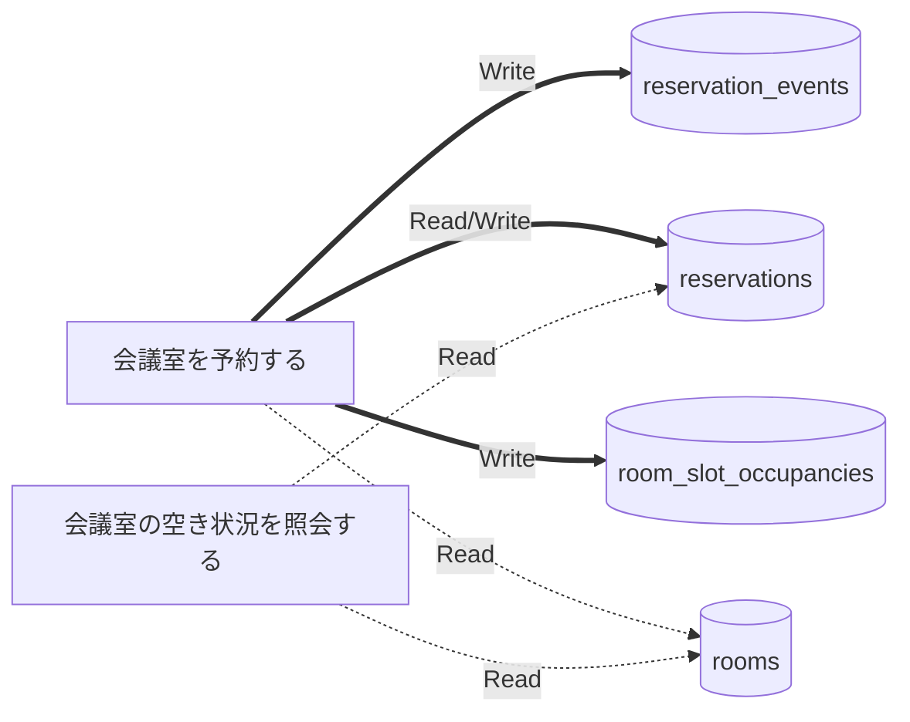

# データフロー (抽出)

UC がどのテーブルを読み書きするか。R = Read、W = Write、RW = 両方。UC ごとの詳しい流れは各 UC の実装の記録の「どう動くか」。

| テーブル | 会議室を予約する | 会議室の空き状況を照会する |
|---|---|---|
| reservation_events | W | - |
| reservations | RW | R |
| room_slot_occupancies | W | - |
| rooms | R | R |

