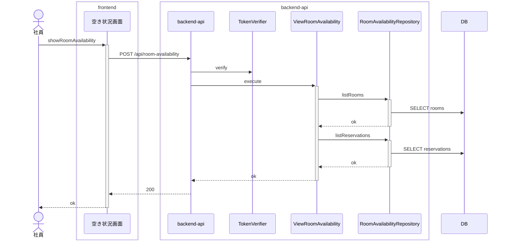
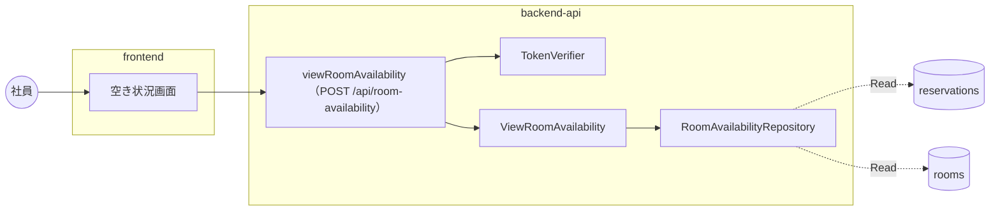

# 会議室予約 / 会議室の空き状況を照会する

<!-- 要約: 表 1 つ (| 項目 | 内容 | 根拠 |)。行は 誰が / 何をする / 完了の条件。内容は 40 字以内、根拠はコード位置 path:line -->
<!-- 要約:begin 概要 -->
| 項目 | 内容 | 根拠 |
|---|---|---|
| 誰が | サインインし、トークンを検証できた社員 | apps/frontend/src/App.tsx:35 apps/backend-api/src/gateway/joseTokenVerifier.ts:57 apps/backend-api/src/presentation/httpApp.ts:132 |
| 何をする | 日付と時間帯を指定して全会議室の空き状況を照会する 画面は日時の時差を Asia/Tokyo の規則で付けて送る | apps/frontend/src/screens/RoomAvailability/RoomAvailabilityScreen.tsx:42 apps/frontend/src/screens/RoomAvailability/toTimeRange.ts:45 apps/backend-api/src/usecase/viewRoomAvailability.ts:79 |
| 完了の条件 | 全会議室が表示順に並ぶ 会議室ごとに空きか予約済みかが返る (200) | apps/backend-api/src/repository/roomAvailabilityRepository.ts:31 apps/backend-api/src/usecase/viewRoomAvailability.ts:100 apps/backend-api/src/presentation/httpApp.ts:167 |
<!-- 要約:end -->

## 結果 (抽出)

| 項目 | 結果 |
|---|---|
| ゲート | 5 段すべて pass |
| 受入基準 | 12 / 12 をシナリオが覆う |
| シナリオ | 14 本中 14 本 pass (受入 12) |
| 実装者が決めた前提 | 25 件 (人が承認 7、自動承認 18) |
| 未決の課題 | なし |
| 計装の範囲 (backend-api) | gateway, presentation, repository, usecase |
| 計装の範囲 (frontend) | api-client, screen |

## 入口 (抽出)

| 種類 | 名前 |
|---|---|
| API | viewRoomAvailability (POST /api/room-availability) |
| 画面 | RoomAvailability |
| 発行イベント | なし |
| 購読イベント | なし |
| 要求 | SPEC-001-01 ([要求仕様書](../../../requirements/requirements.md)) |
| シナリオ | [view-room-availability.feature](../../../../features/%E4%BC%9A%E8%AD%B0%E5%AE%A4%E4%BA%88%E7%B4%84/view-room-availability.feature) |
| 契約 | [contract-slice.json](../../../../contracts/generated/slices/view-room-availability/contract-slice.json) |

主要な部品 (トレースに現れたもの):

- backend-api: RoomAvailabilityRepository、TokenVerifier、ViewRoomAvailability
- frontend: 空き状況画面

## どう動くか (抽出)

正常系: 予約のある会議室は予約済み、予約の無い会議室は空きと表示される

分岐 (他のシナリオとの違い):

| シナリオ | 応答 | 書き込み | 発行 |
|---|---|---|---|
| 30 分刻みでない時刻は照会を受け付けない | 422 | なし | なし |
| 予約の時間帯と一部でも重なる時間帯は予約済みと表示される | 200 | なし | なし |
| 予約の終了時刻から始まる時間帯は空きと表示される | 200 | なし | なし |
| 予約済みの会議室に予約者の名前は表示されない | 200 | なし | なし |
| 会議室名が表示順に並んで表示される | 200 | なし | なし |
| 全会議室が会議室ごとに表示される | 200 | なし | なし |
| 取り消された予約は予約済みとして扱わない | 200 | なし | なし |
| 日をまたぐ時間帯は照会を受け付けない | 422 | なし | なし |
| 終了が翌日 0:00 の時間帯は照会を受け付ける | 200 | なし | なし |
| 過去の時間帯でも重なる有効な予約が無い会議室は空きと表示される | 200 | なし | なし |
| 過去の時間帯の照会は受け付ける | 200 | なし | なし |
| 開始時刻が終了時刻より後の時間帯は照会を受け付けない | 422 | なし | なし |
| 開始時刻と終了時刻が同じ時間帯は照会を受け付けない | 422 | なし | なし |

全シナリオの図は [sequence.md](sequence.md)。

### データの流れ

全シナリオを合算。点線は Read、太線は Write。

## 何を守るか (要約)

<!-- 要約: 表 1 つ (| 守ること | 手段 | 根拠 |)。守ること = 原子性 / 競合 / 冪等 / 障害と副作用。手段は 1 行 1 つ (  区切り、各 40 字以内)、根拠はコード位置 -->
<!-- 要約:begin 整合性 -->
| 守ること | 手段 | 根拠 |
|---|---|---|
| 原子性 | 書き込みが無い (SELECT だけ) 会議室と予約は別の問い合わせで並行に読む | apps/backend-api/src/repository/roomAvailabilityRepository.ts:31 apps/backend-api/src/repository/roomAvailabilityRepository.ts:47 apps/backend-api/src/usecase/viewRoomAvailability.ts:89 |
| 競合 | 2 つの読み取りを取引で束ねない 図の順と違い、2 つの読み取りは同時に始まる 重なりの判定は読んだ後に domain で行う 照会中は画面が次の照会を受け付けない | apps/backend-api/src/usecase/viewRoomAvailability.ts:89 apps/backend-api/src/domain/roomAvailability.ts:27 apps/frontend/src/screens/RoomAvailability/RoomAvailabilityScreen.tsx:44 |
| 冪等 | 照会は状態を変えないので繰り返してよい | apps/backend-api/src/repository/roomAvailabilityRepository.ts:31 apps/backend-api/src/repository/roomAvailabilityRepository.ts:47 |
| 障害と副作用 | トークンが合わなければ本文を読む前に 401 認証基盤の障害は検証器が例外のまま投げる 検証器の例外は error のログと 500 にする 始まりのログはトークンの検証の後に 1 回出す 検証できた要求の始まりのログは社員 ID を持つ 契約に無い経路のハンドラ名は unmatchedRoute 本文の形の誤りと読み込みの要求側の失敗は 400 時間帯の誤りは DB を読む前に 422 順と 30 分刻みは 1 ミリ秒未満まで含めて見る 想定外の例外は 500 と相関 ID を返す 画面は通信の失敗を INTERNAL_ERROR にする サインインの送り出しは終われば成否を問わず外す | apps/backend-api/src/gateway/joseTokenVerifier.ts:61 apps/backend-api/src/presentation/httpApp.ts:136 apps/backend-api/src/presentation/httpApp.ts:148 apps/backend-api/src/gateway/joseTokenVerifier.ts:65 apps/backend-api/src/presentation/httpApp.ts:130 apps/backend-api/src/presentation/httpApp.ts:178 apps/backend-api/src/presentation/httpApp.ts:129 apps/backend-api/src/presentation/httpApp.ts:134 apps/backend-api/src/presentation/httpApp.ts:82 apps/backend-api/src/presentation/httpApp.ts:64 apps/backend-api/src/presentation/httpApp.ts:154 apps/backend-api/src/presentation/httpApp.ts:175 apps/backend-api/src/usecase/viewRoomAvailability.ts:81 apps/backend-api/src/domain/timeRange.ts:79 apps/backend-api/src/domain/timeRange.ts:82 apps/backend-api/src/presentation/httpApp.ts:187 apps/frontend/src/screens/RoomAvailability/showRoomAvailability.ts:44 apps/frontend/src/api/oidcTokenProvider.ts:110 |
<!-- 要約:end -->

## 決めたこと (転記)

仕様に書かれておらず、実装者が決めた前提。検証は Verifier の判定、処遇は人のレビューの結果。

### 人が承認した前提 (7)

| ティア | 分類 | 何を決めたか | 検証 | 場所 |
|---|---|---|---|---|
| backend-api | 永続化 | 予約の候補は業務の日付の 1 日分を読む | **仕様に無い (major)** | roomAvailabilityRepository.ts:48 |
| backend-api | セキュリティ | 認証を本文の形の検証より先に行う | **仕様に無い (major)** | httpApp.ts:110 |
| backend-api | セキュリティ | 本番の設定は 4 つの環境変数から読む | **仕様に無い (major)** | app.ts:57 |
| backend-api | 永続化 | テスト用データは予約・イベント・占有をそろえる | **仕様に無い (major)** | test-app.ts:31 |
| backend-api | セキュリティ | Bearer の語は大文字小文字を区別しない | **仕様に無い (major)** | httpApp.ts:51 |
| backend-api | セキュリティ | 始まりのログはトークンの検証の後に出す | **仕様に無い (major)** | httpApp.ts:66 |
| backend-api | セキュリティ | 認証基盤の障害は 500、トークンの不一致は 401 | **仕様に無い (major)** | joseTokenVerifier.ts:27 |

前提の全文

- **予約の候補は業務の日付の 1 日分を読む** (backend-api): repository は開始が業務の日付の 0:00 以上・翌日 0:00 未満の予約を取消済みも含めて読み、重なりと取消の判定は domain が行う (SQL に重なりの条件を書かない)
- **認証を本文の形の検証より先に行う** (backend-api): /api の要求はトークンの検証を本文の読み込みと形の検証より先に行い、トークンが無いか検証できなければ本文が不正でも 401 を返す
- **本番の設定は 4 つの環境変数から読む** (backend-api): 本番の入口は DATABASE_URL・OIDC_ISSUER・OIDC_AUDIENCE・OIDC_JWKS_URI を環境変数から読み、1 つでも無ければ起動で失敗させる。待ち受けの port は PORT (既定 3000)
- **テスト用データは予約・イベント・占有をそろえる** (backend-api): 契約テストのテスト用データ room-a-reserved-by-employee-a は、予約の今の状態の行に加えて同じ予約の「予約した」イベント (固定の ID と時刻 2026-11-05T09:00:00+09:00) と 10:00・10:30 の 30 分枠の占有を入れる
- **Bearer の語は大文字小文字を区別しない** (backend-api): Authorization ヘッダは Bearer (大文字小文字を区別しない) と空白に続く 1 語のトークンだけを受け、それ以外の形は 401 UNAUTHENTICATED にする
- **始まりのログはトークンの検証の後に出す** (backend-api): /api の要求の始まりのログ (要求を受けた) はトークンの検証の後に 1 回だけ出し、検証できた要求では社員 ID を持たせ、検証できなかった要求 (401) と検証器が例外を投げた要求 (500。本番では認証基盤の障害で起きる。A-019) では社員 ID 無しで出す。/api の外の要求は検証の段の後で 1 回出す。そのため検証器 (gateway) が検証中に出すログは始まりのログより先に並ぶ
- **認証基盤の障害は 500、トークンの不一致は 401** (backend-api): 本番のトークンの検証器は、jose のエラーのうちトークンそのものが合わないもの (JWTExpired・JWTClaimValidationFailed・JWTInvalid・JWSInvalid・JWSSignatureVerificationFailed・JOSEAlgNotAllowed・JOSENotSupported・JWKSNoMatchingKey・JWKSMultipleMatchingKeys のコード) だけを null (401 UNAUTHENTICATED) にする。それ以外 (認証基盤に届かない通信の失敗・鍵の一覧の時間切れ JWKSTimeout・200 でない応答や JSON でない本文の JOSEError・鍵の一覧が壊れている JWKSInvalid や JWKInvalid・想定外) は warn のログを出して例外のまま投げ、presentation の共通の処理が error のログと 500 INTERNAL_ERROR にする。ログにトークンそのものは出さない

### 自動承認した前提 (18)

| ティア | 分類 | 何を決めたか | 検証 | 場所 |
|---|---|---|---|---|
| backend-api | データ形式 | 業務のタイムゾーンは実行環境の組み込みの表で求める | 仕様に無い (minor) | timeRange.ts:19 |
| backend-api | 入力検証 | 日時の形は時差必須・24 時と暦に無い日を弾く | 仕様に無い (minor) | timeRangeRequest.ts:9 |
| backend-api | エラー処理 | 相関 ID は要求ごとに作りヘッダで返す | 仕様に無い (minor) | httpApp.ts:85 |
| backend-api | エラー処理 | 契約に合わない会議室 ID はシステムのエラー | 仕様に無い (minor) | ids.ts:9 |
| backend-api | データ形式 | 表示順が同じ会議室は会議室 ID 順 | 仕様に無い (minor) | roomAvailabilityRepository.ts:31 |
| backend-api | エラー処理 | 500 の title の文言 | 仕様に無い (minor) | problem.ts:19 |
| backend-api | エラー処理 | 業務のエラーの detail は理由ごとの直し方 | 仕様に無い (minor) | problem.ts:34 |
| backend-api | エラー処理 | detail は業務のエラーだけに付ける | 仕様に無い (minor) | problem.ts:53 |
| backend-api | エラー処理 | 本文の読み込みの要求側の失敗は 400 の形の誤り | 仕様に無い (minor) | httpApp.ts:193 |
| backend-api | 入力検証 | うるう秒 (秒 60) は形の誤り | 仕様に無い (minor) | timeRangeRequest.ts:10 |
| backend-api | 入力検証 | JSON 以外の Content-Type は 400 | 仕様に無い (minor) | httpApp.ts:144 |
| backend-api | データ形式 | 時点は 1 ミリ秒未満まで持って比べる | 仕様に無い (minor) | timeRange.ts:79 |
| backend-api | エラー処理 | 契約に無い経路は固定のハンドラ名と既定の 404 | 仕様に無い (minor) | httpApp.ts:57 |
| frontend | データ形式 | 送る日時の時差は Asia/Tokyo の tz 規則 | 仕様に無い (minor) | businessTimeZone.ts:68 |
| frontend | データ形式 | 2 回ある時刻は早い方、無い時刻は飛ぶ前の時差 | 仕様に無い (minor) | businessTimeZone.ts:75 |
| frontend | データ形式 | 分で書けない時差の日は UTC (Z) で送る | 仕様に無い (minor) | businessTimeZone.ts:93 |
| frontend | 入力検証 | path の区切りは復号し、壊れた符号化はそのまま | 仕様に無い (minor) | navigation.ts:19 |
| frontend | エラー処理 | code 無しの応答と通信失敗は内部エラー | 仕様に無い (minor) | showRoomAvailability.ts:17 |

前提の全文

- **業務のタイムゾーンは実行環境の組み込みの表で求める** (backend-api): Asia/Tokyo の日付と 30 分刻みの判定を、実行環境の TZ に依存させず、言語の組み込みの Intl.DateTimeFormat (timeZone Asia/Tokyo) のタイムゾーンの表で行う。業務の日付の 0:00 は日本時間の日付がその日になる最も早い時点 (夏時間の始まりの日は 1:00、終わりの日は 1 回目の 0:00)、翌日 0:00 も同じ決め方で求め、1 日を 24 時間と決めつけない (23 時間・25 時間の日がある)。30 分刻みは日本時間の分が 0 か 30 で秒・ミリ秒が 0 のときとする
- **日時の形は時差必須・24 時と暦に無い日を弾く** (backend-api): 本文の startAt・endAt は時差付きの RFC 3339 だけを受け、時差の省略・時の 24・暦に無い日付 (2026-02-30 など)・契約に無い項目・文字列でない値を 400 VALIDATION_ERROR にする。小数の秒は桁数の上限なしに形としては受け、1 ミリ秒未満の数字も落とさずに domain の時間帯へ渡す (時間帯の検査の順と 30 分刻みは全精度で判定され、30 分刻みでなければ 422 NOT_ON_30_MINUTES になる)
- **相関 ID は要求ごとに作りヘッダで返す** (backend-api): 相関 ID は受けたヘッダを使わず要求ごとに UUID で作り、応答のヘッダ x-correlation-id とエラー応答の Problem.correlationId (400・401・422・500 のすべて) に載せる
- **契約に合わない会議室 ID はシステムのエラー** (backend-api): DB から読んだ会議室 ID が契約 RoomId の長さ (1〜64) に合わなければ例外にし、500 INTERNAL_ERROR で返す
- **表示順が同じ会議室は会議室 ID 順** (backend-api): 会議室は display_order の昇順に並べ、同じ値のときは room_id の昇順にする
- **500 の title の文言** (backend-api): システムのエラーの Problem の title は「システムのエラーが発生しました。時間をおいて試してください」とする
- **業務のエラーの detail は理由ごとの直し方** (backend-api): 業務のエラーの Problem の detail に利用者の直し方を載せる。INVALID_TIME_RANGE は domain が返す理由 (開始が終了より前でない START_NOT_BEFORE_END / 業務の日付に収まらない OUTSIDE_BUSINESS_DAY) で文を分け、NOT_ON_30_MINUTES は「開始と終了の時刻は 0 分か 30 分ちょうどにしてください」とする
- **detail は業務のエラーだけに付ける** (backend-api): detail を付けるのは業務のエラー (422) だけにし、要求の形の誤り 400 VALIDATION_ERROR・認証の 401 UNAUTHENTICATED・システムのエラー 500 INTERNAL_ERROR の Problem には detail を付けない
- **本文の読み込みの要求側の失敗は 400 の形の誤り** (backend-api): 本文の読み込みの失敗のうち要求の側に原因があるもの (express.json が type と 4xx の status を付ける失敗。JSON として読めない・既定の上限 100kb を超えた 413・文字コードや圧縮が扱えない 415・途中で切れた・長さが合わない) を 400 VALIDATION_ERROR にし、エラーのログを出さない。サーバ側の読み込みの失敗 (5xx の stream.*) と想定外の例外だけを 500 INTERNAL_ERROR とシステムのエラーのログにする。本文の大きさの上限は express.json の既定のまま
- **うるう秒 (秒 60) は形の誤り** (backend-api): 日時の秒は 00〜59 だけを受け、RFC 3339 が認めるうるう秒の表記 (秒 60) は 400 VALIDATION_ERROR にする
- **JSON 以外の Content-Type は 400** (backend-api): Content-Type が application/json でない要求の本文は読まず、本文が無いものとして 400 VALIDATION_ERROR にする (契約に無い 415 を返さない)
- **時点は 1 ミリ秒未満まで持って比べる** (backend-api): 時間帯の生成は Date に加えて、切り捨てたミリ秒 (epochMs) と 1 ミリ秒未満の数字 (subMillisecondDigits) を分けて持つ時点を受け、開始が終了より前かの判定を 1 ミリ秒未満まで含めた全精度で行う (桁数の違う同じ時点は等しい)。30 分刻みは 1 ミリ秒未満の数字がすべて 0 のときだけとする。日付に収まるかの判定は 30 分刻みを満たした後なので epoch ms で行う
- **契約に無い経路は固定のハンドラ名と既定の 404** (backend-api): 契約に無い経路の要求は、ハンドラの名前を未定義の経路を示す固定の値 unmatchedRoute にして始まりと終わりのログ (と検証器・エラーのログの文脈) に持たせ、Express の既定の 404 (Problem でない本文) を返す
- **送る日時の時差は Asia/Tokyo の tz 規則** (frontend): 画面が組み立てる日時の時差は固定の +09:00 にせず、Intl.DateTimeFormat (timeZone Asia/Tokyo) の tz データで、その日時の時差を求めて付ける (1948〜1951 年の夏時間の日は +10:00)。今日の日付の初期値も同じ規則で求める
- **2 回ある時刻は早い方、無い時刻は飛ぶ前の時差** (frontend): 夏時間の終わりで 2 回ある日本時間の時刻 (例 1949-09-11 0:00) は早い方 (+10:00) の瞬間にし、夏時間の始まりで飛ばされて無い時刻 (例 1949-04-03 0:00) は飛ぶ前の時差 (+09:00) で読んだ瞬間 (= 1:00 +10:00) にする。どちらも日付の 0:00 と終了の 24:00 がその日付の始まりと終わりの瞬間に合う
- **分で書けない時差の日は UTC (Z) で送る** (frontend): Asia/Tokyo の時差が分の単位で書けない日 (1888 年より前の地方時 +09:18:59) は、日本時間で選んだ時刻と同じ瞬間を UTC (Z) の日時で送る (例 1880-01-01 10:00 は 1880-01-01T00:41:01Z)
- **path の区切りは復号し、壊れた符号化はそのまま** (frontend): path の :name の区切りの値は decodeURIComponent で復号してから params に入れる。復号できない値 (壊れた符号化。例 %E0) は例外で描画を止めず、復号しないそのままの値を params に入れる (値の検証は受け取った画面と API に任せる)
- **code 無しの応答と通信失敗は内部エラー** (frontend): 照会の応答が 200 でなく本文に文字列の code が無いとき (showRoomAvailability.ts:21) と、応答を受け取れなかったとき (通信の失敗で fetch が例外を投げたとき。同 :45) は、画面のエラーの状態を契約のエラーのコード INTERNAL_ERROR にして出す。再試行はしない

### Verifier が見つけた未申告の判断 (5)

| ティア | 判断 | 場所 |
|---|---|---|
| backend-api | ハンドラの名前は method と path の文字列の完全一致で契約から引くため、契約の経路と大文字小文字・末尾のスラッシュだけが違う要求 (例 POST /api/room-availability/ や /API/room-availability) は Express の既定の経路の照合で viewRoomAvailability のハンドラが処理するのに、始まり・終わり・検証器・usecase のログのハンドラ名は unmatchedRoute になる | httpApp.ts:60 |
| frontend | サインインへの送り出しは進行中の 1 つにまとめ (重ねて呼ばれたら同じ送り出しを返す)、送り出しが終わったら成功・失敗のどちらでも外して次の呼び出しで送り直す (ブラウザの「戻る」で oidc-client-ts が送り出しを成功で終えた後も送り直せるようにする) | oidcTokenProvider.ts:107 |
| frontend | トークンが無いとき (メモリに無い・リフレッシュトークンが無い・更新に失敗) の getAccessToken は、サインインへの送り出しを始めてその終わりを待たずに undefined を返し、送り出しの失敗はそこでは握りつぶす (失敗は呼び出し元の続きの signIn で返る)。そのため API 呼び出しは Authorization ヘッダ無しで送られ、401 の signIn が進行中の送り出しに乗る | oidcTokenProvider.ts:145 |
| frontend | サインインのコールバックで完了の呼び出し (signinRedirectCallback) が失敗したら、戻り先へ移らず UNAUTHENTICATED の理由の文を表示する。完了の呼び出しは StrictMode の再実行でも 1 回だけにする | AuthCallbackScreen.tsx:28 |
| frontend | 空き状況の画面を開いたときの時間帯の初期値は、今日 (Asia/Tokyo の日付) の 9:00〜10:00 とし、照会するまで一覧を出さない | initialSlot.ts:5 |

## 課題 (抽出 + 要約)

未決の課題なし。

<!-- 要約: 表 1 つ (| 課題 | 背景 | 今の実装 | 対処 | 根拠 |)。課題 1 つ 1 行、セルは 40 字以内、根拠はコード位置 -->
<!-- 要約:begin 課題 -->
| 課題 | 背景 | 今の実装 | 対処 | 根拠 |
|---|---|---|---|---|
| ログのハンドラ名が処理と食い違う要求がある | 契約の経路と大小文字・末尾の / だけ違う要求 | ハンドラ名は method と path の完全一致で引く 経路の照合は大小文字と末尾の / を区別しない 契約のハンドラが処理しログは unmatchedRoute | 直すなら照合の規則とハンドラ名の引き方を揃える 決めたことの Verifier の判断に載り人が見た 人は attempt 2 を進めると承認した この指摘だけの決定は無く未決の課題に数えない | apps/backend-api/src/presentation/httpApp.ts:63 apps/backend-api/src/presentation/httpApp.ts:70 apps/backend-api/src/presentation/httpApp.ts:150 .distillery/runs/view-room-availability/attempt-2/findings.backend-api.yaml:395 .distillery/runs/view-room-availability/decisions.jsonl:54 |
<!-- 要約:end -->

## 証跡 (抽出)

ゲート: static pass / unit pass / contract pass / uc-bdd pass / acceptance pass

| ティア | 単体 (pass/total) | 契約 (pass/total) |
|---|---|---|
| frontend | 63/63 | - |
| backend-api | 84/84 | 12/12 |

受入基準の対応:

| 基準 | 内容 | シナリオ (結果) |
|---|---|---|
| SPEC-001-01-1 | Given 会議室が 5 部屋登録されている When 社員が日付と時間帯を指定して空き状況を表示する Then 5 部屋すべてが会議室ごとに表示される | 全会議室が会議室ごとに表示される (passed) |
| SPEC-001-01-2 | Given 会議室A〜会議室E の 5 部屋が表示順 1〜5 で登録されている When 社員が日付と時間帯を指定して空き状況を表示する Then 会議室名が 会議室A・会議室B・会議室C・会議室D・会議室E の順に並んで表示される | 会議室名が表示順に並んで表示される (passed) |
| SPEC-001-01-3 | Given 会議室Aの 2026-11-10 10:00-11:00 に予約がある When 社員が 2026-11-10 10:00-11:00 の空き状況を表示する Then 会議室Aは予約済み、予約の無い会議室は空きと表示される | 予約のある会議室は予約済み、予約の無い会議室は空きと表示される (passed) |
| SPEC-001-01-4 | Given 会議室Aの 2026-11-10 10:00-11:00 に社員Aの予約がある When 社員Bが 2026-11-10 10:00-11:00 の空き状況を表示する Then 会議室Aは予約済みとだけ表示され、予約者である社員Aの名前は表示されない | 予約済みの会議室に予約者の名前は表示されない (passed) |
| SPEC-001-01-5 | Given 会議室Aの 2026-11-10 10:00-11:00 に予約がある When 社員が 2026-11-10 11:00-12:00 の空き状況を表示する Then 会議室Aは空きと表示される | 予約の終了時刻から始まる時間帯は空きと表示される (passed) |
| SPEC-001-01-6 | Given 会議室Aの 2026-11-10 10:00-11:00 の予約が取り消されている When 社員が同じ時間帯の空き状況を表示する Then 会議室Aは空きと表示される | 取り消された予約は予約済みとして扱わない (passed) |
| SPEC-001-01-7 | Given 会議室が 5 部屋登録されている When 社員が 2026-11-10 の開始時刻 11:00・終了時刻 10:00 で空き状況を表示しようとする Then 空き状況は表示されず、時間帯が正しくないことが示される | 開始時刻が終了時刻より後の時間帯は照会を受け付けない (passed) |
| SPEC-001-01-8 | Given 会議室が 5 部屋登録されている When 社員が 2026-11-10 の開始時刻 10:00・終了時刻 10:00 で空き状況を表示しようとする Then 空き状況は表示されず、時間帯が正しくないことが示される | 開始時刻と終了時刻が同じ時間帯は照会を受け付けない (passed) |
| SPEC-001-01-9 | Given 会議室が 5 部屋登録されている When 社員が 2026-11-10 の開始時刻 10:10・終了時刻 11:00 で空き状況を表示しようとする Then 空き状況は表示されず、時刻は 30 分刻みで指定することが示される | 30 分刻みでない時刻は照会を受け付けない (passed) |
| SPEC-001-01-10 | Given 会議室Aの 2026-11-10 23:30-翌日0:00 に予約がある When 社員が 2026-11-10 の開始時刻 23:30・終了時刻 翌日 0:00 (24:00) で空き状況を表示する Then 照会は受け付けられ、会議室Aは予約済み、予約の無い会議室は空きと表示される | 終了が翌日 0:00 の時間帯は照会を受け付ける (passed) |
| SPEC-001-01-11 | Given 会議室が 5 部屋登録されている When 社員が 2026-11-10 の開始時刻 23:00・終了時刻 翌日 1:00 で空き状況を表示しようとする Then 空き状況は表示されず、時間帯が正しくないことが示される | 日をまたぐ時間帯は照会を受け付けない (passed) |
| SPEC-001-01-12 | Given 現在が 2026-11-10 12:00 で、会議室Aの 2026-11-10 10:00-11:00 に予約がある When 社員が 2026-11-10 10:00-11:00 の空き状況を表示する Then 照会は受け付けられ、会議室Aは予約済み、予約の無い会議室は空きと表示される | 過去の時間帯の照会は受け付ける (passed) |

## 付録 (抽出)

変更ファイル (65)

- backend-api (10)
  - apps/backend-api/src/app.test.ts
  - apps/backend-api/src/domain/businessError.ts
  - apps/backend-api/src/domain/result.ts
  - apps/backend-api/src/gateway/joseTokenVerifier.test.ts
  - apps/backend-api/src/gateway/joseTokenVerifier.ts
  - apps/backend-api/src/gateway/jwksTestServer.ts
  - apps/backend-api/src/presentation/httpApp.test.ts
  - apps/backend-api/src/presentation/httpApp.ts
  - apps/backend-api/src/presentation/problem.ts
  - apps/backend-api/src/presentation/timeRangeRequest.ts
- frontend (10)
  - apps/frontend/src/App.tsx
  - apps/frontend/src/api/authorizedFetch.ts
  - apps/frontend/src/api/oidcTokenProvider.test.ts
  - apps/frontend/src/api/oidcTokenProvider.ts
  - apps/frontend/src/api/roomAvailabilityApi.ts
  - apps/frontend/src/api/tokenProvider.ts
  - apps/frontend/src/navigation.ts
  - apps/frontend/src/routes.tsx
  - apps/frontend/src/screens/AuthCallback/AuthCallbackScreen.tsx
  - apps/frontend/vite.config.ts
- その他 (45)
  - .distillery/runs/view-room-availability/attempt-1/assumptions.backend-api.yaml
  - .distillery/runs/view-room-availability/attempt-1/assumptions.frontend.yaml
  - .distillery/runs/view-room-availability/attempt-1/findings.backend-api.yaml
  - .distillery/runs/view-room-availability/attempt-1/findings.frontend.yaml
  - .distillery/runs/view-room-availability/attempt-2/assumptions.backend-api.yaml
  - .distillery/runs/view-room-availability/attempt-2/assumptions.frontend.yaml
  - .distillery/runs/view-room-availability/attempt-2/attempt.json
  - .distillery/runs/view-room-availability/attempt-2/findings.backend-api.yaml
  - .distillery/runs/view-room-availability/attempt-2/findings.frontend.yaml
  - .distillery/runs/view-room-availability/decisions.jsonl
  - .distillery/runs/view-room-availability/events.jsonl
  - .distillery/runs/view-room-availability/handoff/contract-20261110T032600Z.yaml
  - .distillery/runs/view-room-availability/handoff/integrate-20261110T033454Z.yaml
  - .distillery/runs/view-room-availability/handoff/integrate-20261110T040623Z.yaml
  - .distillery/runs/view-room-availability/handoff/refute-implementation-backend-api-20261110T034156Z.yaml
  - .distillery/runs/view-room-availability/handoff/refute-implementation-backend-api-20261110T041102Z.yaml
  - .distillery/runs/view-room-availability/handoff/refute-implementation-frontend-20261110T034156Z.yaml
  - .distillery/runs/view-room-availability/handoff/scaffold-20261110T032748Z.yaml
  - .distillery/runs/view-room-availability/handoff/scenario-20261110T032146Z.yaml
  - .distillery/runs/view-room-availability/handoff/scenario-refute-20261110T032424Z.yaml
  - .distillery/runs/view-room-availability/handoff/tier-backend-api-20261110T032927Z.yaml
  - .distillery/runs/view-room-availability/handoff/tier-backend-api-20261110T035642Z.yaml
  - .distillery/runs/view-room-availability/handoff/tier-frontend-20261110T032927Z.yaml
  - .distillery/runs/view-room-availability/invalidated/20261110_035623_contract-gate.done.yaml
  - .distillery/runs/view-room-availability/invalidated/20261110_035623_integrate.done.yaml
  - .distillery/runs/view-room-availability/invalidated/20261110_035623_tier.done.yaml
  - .distillery/runs/view-room-availability/invalidated/20261110_035623_verify.done.yaml
  - .distillery/runs/view-room-availability/reviews/implementation-backend-api/1/prompt-round1.md
  - .distillery/runs/view-room-availability/reviews/implementation-backend-api/1/round1.md
  - .distillery/runs/view-room-availability/reviews/implementation-backend-api/2/prompt-round1.md
  - .distillery/runs/view-room-availability/reviews/implementation-backend-api/2/round1.md
  - .distillery/runs/view-room-availability/reviews/implementation-frontend/1/prompt-round1.md
  - .distillery/runs/view-room-availability/reviews/implementation-frontend/1/round1.md
  - .distillery/runs/view-room-availability/reviews/scenario/1/prompt-round1.md
  - .distillery/runs/view-room-availability/reviews/scenario/1/round1.md
  - .distillery/runs/view-room-availability/stages/contract-gate.done.yaml
  - .distillery/runs/view-room-availability/stages/contract.done.yaml
  - .distillery/runs/view-room-availability/stages/integrate.done.yaml
  - .distillery/runs/view-room-availability/stages/review.done.yaml
  - .distillery/runs/view-room-availability/stages/scaffold.done.yaml
  - .distillery/runs/view-room-availability/stages/scenario.done.yaml
  - .distillery/runs/view-room-availability/stages/tier.done.yaml
  - .distillery/runs/view-room-availability/stages/verify.done.yaml
  - docs/README.md
  - features/会議室予約/view-room-availability.feature

シナリオの実行結果 (14)

| シナリオ | 種別 | 結果 | 時間 (ms) |
|---|---|---|---|
| 30 分刻みでない時刻は照会を受け付けない | 受入 | passed | 553 |
| 予約のある会議室は予約済み、予約の無い会議室は空きと表示される | 受入 | passed | 515 |
| 予約の時間帯と一部でも重なる時間帯は予約済みと表示される | UC | passed | 465 |
| 予約の終了時刻から始まる時間帯は空きと表示される | 受入 | passed | 535 |
| 予約済みの会議室に予約者の名前は表示されない | 受入 | passed | 502 |
| 会議室名が表示順に並んで表示される | 受入 | passed | 546 |
| 全会議室が会議室ごとに表示される | 受入 | passed | 692 |
| 取り消された予約は予約済みとして扱わない | 受入 | passed | 501 |
| 日をまたぐ時間帯は照会を受け付けない | 受入 | passed | 530 |
| 終了が翌日 0:00 の時間帯は照会を受け付ける | 受入 | passed | 637 |
| 過去の時間帯でも重なる有効な予約が無い会議室は空きと表示される | UC | passed | 470 |
| 過去の時間帯の照会は受け付ける | 受入 | passed | 568 |
| 開始時刻が終了時刻より後の時間帯は照会を受け付けない | 受入 | passed | 491 |
| 開始時刻と終了時刻が同じ時間帯は照会を受け付けない | 受入 | passed | 496 |

生成情報

- 上流: requirements@64517f4 adr@ed9e1fb contracts@0ff5299
- コード: 2985951
- 生成日時: 2026-11-10T04:17:46.482Z / 実行試行: 2
- モデル: 実装 claude-opus-5-5 / 検証 claude-opus-5-5 / オーケストレータ claude-opus-5-5
- 凡例: (抽出) はスクリプトが生成、(要約) は LLM がコード位置を根拠に書く、(転記) は実行記録からの写し

