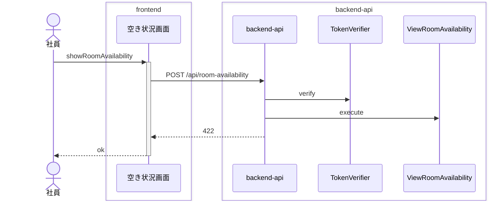
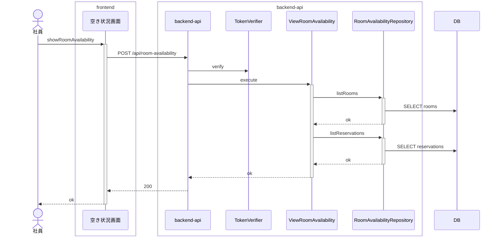

<!-- basis: requirements@64517f420b568ea1a4536b71b9dbbb357bd66460 adr@ed9e1fbd3b234cada613ca9357dd6e5ae36271e8 contracts@0ff5299f454e51558068882d06530ff940c50f62 | generated_at: 2026-11-10T04:17:46.482Z | slug: view-room-availability -->

# 会議室予約 / 会議室の空き状況を照会する — 全シナリオのシーケンス (抽出)

アクターは 社員。正常系は [index.md](index.md) の「どう動くか」にも載せている。

## 30 分刻みでない時刻は照会を受け付けない

## 予約のある会議室は予約済み、予約の無い会議室は空きと表示される

## 予約の時間帯と一部でも重なる時間帯は予約済みと表示される

## 予約の終了時刻から始まる時間帯は空きと表示される

## 予約済みの会議室に予約者の名前は表示されない

## 会議室名が表示順に並んで表示される

## 全会議室が会議室ごとに表示される

## 取り消された予約は予約済みとして扱わない

## 日をまたぐ時間帯は照会を受け付けない

## 終了が翌日 0:00 の時間帯は照会を受け付ける

## 過去の時間帯でも重なる有効な予約が無い会議室は空きと表示される

## 過去の時間帯の照会は受け付ける

## 開始時刻が終了時刻より後の時間帯は照会を受け付けない

## 開始時刻と終了時刻が同じ時間帯は照会を受け付けない

