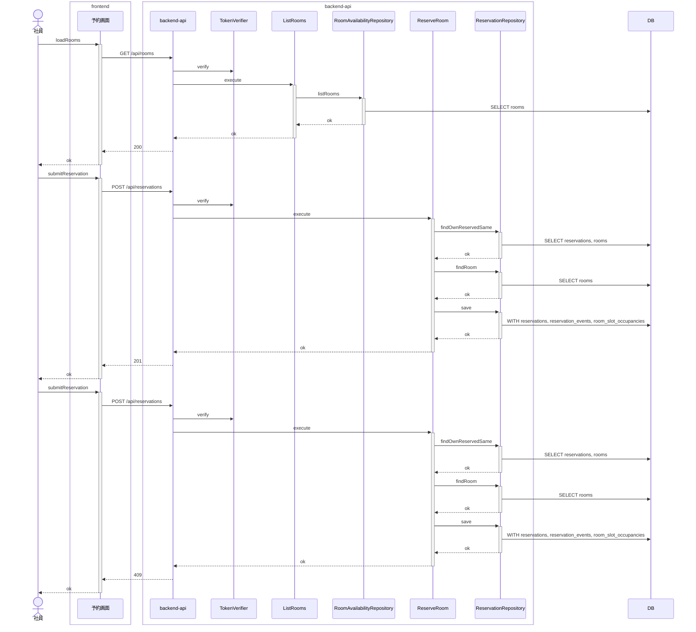
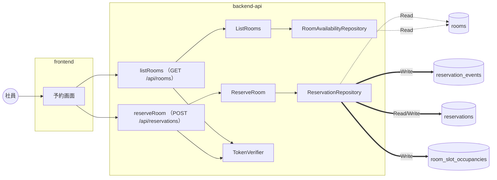

# 会議室予約 / 会議室を予約する

<!-- 要約: 表 1 つ (| 項目 | 内容 | 根拠 |)。行は 誰が / 何をする / 完了の条件。内容は 40 字以内、根拠はコード位置 path:line -->
<!-- 要約:begin 概要 -->
| 項目 | 内容 | 根拠 |
|---|---|---|
| 誰が | トークンで認証された社員が予約者になる | apps/backend-api/src/presentation/httpApp.ts:132 apps/backend-api/src/presentation/httpApp.ts:142 apps/backend-api/src/presentation/httpApp.ts:201 |
| 何をする | 会議室と開始・終了の日時を送って予約する | apps/frontend/src/screens/ReserveRoom/submitReservation.ts:41 |
| 完了の条件 | 新しい予約は 3 表を書いて 201 を返す 同じ内容の自分の有効な予約があれば 200 で返す | apps/backend-api/src/repository/reservationRepository.ts:114 apps/backend-api/src/usecase/reserveRoom.ts:131 apps/backend-api/src/presentation/httpApp.ts:223 |
<!-- 要約:end -->

## 結果 (抽出)

| 項目 | 結果 |
|---|---|
| ゲート | 5 段すべて pass |
| 受入基準 | 20 / 20 をシナリオが覆う |
| シナリオ | 28 本中 28 本 pass (受入 20) |
| 実装者が決めた前提 | 20 件 (推奨案で承認 3、自動承認 17) |
| 未決の課題 | 10 件 (foundation 1、plugin 5、要求 3、ルール 1) |
| 計装の範囲 (backend-api) | gateway, presentation, repository, usecase |
| 計装の範囲 (frontend) | api-client, screen |

## 入口 (抽出)

| 種類 | 名前 |
|---|---|
| API | listRooms (GET /api/rooms)、reserveRoom (POST /api/reservations) |
| 画面 | ReserveRoom、RoomAvailability |
| 発行イベント | なし |
| 購読イベント | なし |
| 要求 | SPEC-002-01, SPEC-002-02, SPEC-002-03 ([要求仕様書](../../../requirements/requirements.md)) |
| シナリオ | [reserve-room.feature](../../../../features/%E4%BC%9A%E8%AD%B0%E5%AE%A4%E4%BA%88%E7%B4%84/reserve-room.feature) |
| 契約 | [contract-slice.json](../../../../contracts/generated/slices/reserve-room/contract-slice.json) |

主要な部品 (トレースに現れたもの):

- backend-api: ListRooms、ReservationRepository、ReserveRoom、RoomAvailabilityRepository、TokenVerifier
- frontend: 予約画面

## どう動くか (抽出)

正常系: 同時に予約されても成立するのは 1 件だけである

分岐 (他のシナリオとの違い):

| シナリオ | 応答 | 書き込み | 発行 |
|---|---|---|---|
| 他の社員の予約とまったく同じ時間帯は送り直しとして扱わず予約できない | 200 → 409 | reservation_events, reservations, room_slot_occupancies | なし |
| 会議室を選ばずに予約すると、予約は送られず会議室を選ぶことが示される | - | なし | なし |
| 別の会議室の同じ時間帯は予約できる | 200 → 201 | reservation_events, reservations, room_slot_occupancies | なし |
| 取り消された予約と同じ時間帯は予約できる | 200 → 201 | reservation_events, reservations, room_slot_occupancies | なし |
| 取り消した自分の予約と同じ内容でも、開始時刻を過ぎていれば過去の時間帯として予約できない | 200 → 422 | なし | なし |
| 取り消した自分の予約と同じ内容で予約すると新しい予約が成立する | 200 → 201 | reservation_events, reservations, room_slot_occupancies | なし |
| 応答を受け取った後に自分の予約と同じ内容で送り直しても、重なりとして断られず成立済みの予約が示される | 200 → 200 | なし | なし |
| 既存の予約と時間帯が一部重なる予約はできない | 200 → 409 | reservation_events, reservations, room_slot_occupancies | なし |
| 既存の予約の時間帯を含む予約はできない | 200 → 409 | reservation_events, reservations, room_slot_occupancies | なし |
| 既存の予約の終了時刻から始まる予約はできる | 200 → 201 | reservation_events, reservations, room_slot_occupancies | なし |
| 既存の予約の開始前から始まり一部重なる予約はできない | 200 → 409 | reservation_events, reservations, room_slot_occupancies | なし |
| 既存の予約の開始時刻に終わる予約はできる | 200 → 201 | reservation_events, reservations, room_slot_occupancies | なし |
| 日をまたぐ時間帯は予約できない | 200 → 422 | なし | なし |
| 日付・開始時刻・終了時刻を選ばずに予約すると、予約は送られずそれぞれを選ぶことが示される | 200 | なし | なし |
| 空いている会議室を予約すると予約が成立し、予約者が記録される | 200 → 201 | reservation_events, reservations, room_slot_occupancies | なし |
| 終了が翌日 0:00 の時間帯は予約できる | 200 → 201 | reservation_events, reservations, room_slot_occupancies | なし |
| 終了時刻が 30 分刻みでない時間帯は予約できない | 200 → 422 | なし | なし |
| 終了時刻だけを選ばずに予約すると、予約は送られず終了時刻を選ぶことだけが示される | 200 | なし | なし |
| 終了時刻を過ぎてから送り直しても過去の時間帯として断られず、成立済みの予約が示される | 200 → 200 | なし | なし |
| 自分の予約と同じ内容で送り直すと、新しい予約は作られず成立済みの予約が示される | 200 → 200 | なし | なし |
| 自分の予約と時間帯が一部だけ重なる予約はできない | 200 → 409 | reservation_events, reservations, room_slot_occupancies | なし |
| 過去の時間帯は予約できない | 200 → 422 | なし | なし |
| 開始時刻が 30 分刻みでない時間帯は予約できない | 200 → 422 | なし | なし |
| 開始時刻が現在と同じ時間帯は予約できる | 200 → 201 | reservation_events, reservations, room_slot_occupancies | なし |
| 開始時刻が終了時刻より後の時間帯は予約できない | 200 → 422 | なし | なし |
| 開始時刻と終了時刻が同じ時間帯は予約できない | 200 → 422 | なし | なし |
| 開始時刻を過ぎてから送り直しても過去の時間帯として断られず、成立済みの予約が示される | 200 → 200 | なし | なし |

全シナリオの図は [sequence.md](sequence.md)。

### データの流れ

全シナリオを合算。点線は Read、太線は Write。

## 何を守るか (要約)

<!-- 要約: 表 1 つ (| 守ること | 手段 | 根拠 |)。守ること = 原子性 / 競合 / 冪等 / 障害と副作用。手段は 1 行 1 つ (  区切り、各 40 字以内)、根拠はコード位置 -->
<!-- 要約:begin 整合性 -->
| 守ること | 手段 | 根拠 |
|---|---|---|
| 原子性 | 3 表を WITH 句をつないだ 1 つの文で書く 文ごとに全部書けるか何も書かないかになる 枠の重なりの違反のときは文ごと取り消される 分岐の表の 409 の書き込みは取り消された文 | apps/backend-api/src/repository/reservationRepository.ts:114 apps/backend-api/src/repository/reservationRepository.ts:95 apps/backend-api/src/repository/reservationRepository.ts:96 apps/backend-api/src/repository/reservationRepository.ts:132 |
| 競合 | 30 分枠の占有の主キーで重なりを止める 主キーの違反は overlaps を返す usecase が overlaps を SLOT_OVERLAPS にする 画面は応答の code をエラーの状態にする 抽出の図の 409 の経路の ok は例外が無いことだけを示す | apps/backend-api/src/repository/reservationRepository.ts:143 apps/backend-api/src/repository/reservationRepository.ts:132 apps/backend-api/src/usecase/reserveRoom.ts:148 apps/frontend/src/screens/ReserveRoom/submitReservation.ts:54 |
| 冪等 | 時間帯を検証した後に送り直しを探す 予約者・会議室・開始・終了が同じ予約済みを探す 取消済みの予約は送り直しとして扱わない 送り直しは過去の時間帯の検査より先に判定する 見つかれば書き込まず成立済みの予約を返す 送り直しは 200、新しい予約は 201 で返す 同時の同じ内容の送信は片方が 409 になる 画面は 200 と 201 を同じ成立として示す 画面は送信中の 2 回目の送信を止める | apps/backend-api/src/usecase/reserveRoom.ts:111 apps/backend-api/src/repository/reservationRepository.ts:67 apps/backend-api/src/repository/reservationRepository.ts:71 apps/backend-api/src/usecase/reserveRoom.ts:114 apps/backend-api/src/usecase/reserveRoom.ts:131 apps/backend-api/src/presentation/httpApp.ts:223 apps/backend-api/src/usecase/reserveRoom.ts:148 apps/frontend/src/screens/ReserveRoom/submitReservation.ts:51 apps/frontend/src/screens/ReserveRoom/ReserveRoomScreen.tsx:133 |
| 障害と副作用 | 主キー以外の失敗は投げ直す 投げ直した失敗は 500 INTERNAL_ERROR にする 画面は応答が無いと INTERNAL_ERROR を出す 「予約した」のログは書けた後だけ出す 送り直しは別の文言の info のログを出す | apps/backend-api/src/repository/reservationRepository.ts:133 apps/backend-api/src/presentation/httpApp.ts:243 apps/frontend/src/screens/ReserveRoom/submitReservation.ts:56 apps/backend-api/src/usecase/reserveRoom.ts:150 apps/backend-api/src/usecase/reserveRoom.ts:129 |
<!-- 要約:end -->

## 決めたこと (転記)

仕様に書かれておらず、実装者が決めた前提。検証は Verifier の判定、処遇は人レビューの段の結果。

### 推奨案で承認した前提 (3)

| ティア | 分類 | 何を決めたか | 検証 | 場所 |
|---|---|---|---|---|
| backend-api | 永続化 | 予約の 3 表を 1 つの SQL の文で書く | **仕様に無い (major)** | reservationRepository.ts:99 |
| backend-api | 永続化 | 重なりは占有の主キーの違反だけで判定 | **仕様に無い (major)** | reservationRepository.ts:140 |
| backend-api | セキュリティ | 送り直しを業務のログに info で出す | **仕様に無い (major)** | reserveRoom.ts:129 |

前提の全文

- **予約の 3 表を 1 つの SQL の文で書く** (backend-api): 予約の今の状態・「予約した」イベント・30 分枠の占有を、データを変える WITH 句をつないだ 1 つの INSERT の文で書き、文ごとに全部書けるか何も書かないかにする (BEGIN/COMMIT を別の要求で送らない)
- **重なりは占有の主キーの違反だけで判定** (backend-api): 予約の前にアプリで重なる予約を読んで確かめることはせず、30 分枠の占有の主キー (room_slot_occupancies_pkey) の違反 (SQLSTATE 23505) だけを repository が 'overlaps' の値で返す。ほかの一意制約の違反 (予約 ID の重複など) は重なりにせず、システムのエラーのまま投げる
- **送り直しを業務のログに info で出す** (backend-api): 送り直しで成立済みの予約を返したときは、usecase が info で「送り直しのため成立済みの予約を返した」を、相関 ID・ハンドラ名・社員 ID・予約 ID・会議室 ID・開始・終了付きで 1 行出す (「予約した」のログは出さない)

### 自動承認した前提 (17)

| ティア | 分類 | 何を決めたか | 検証 | 場所 |
|---|---|---|---|---|
| backend-api | データ形式 | 応答の日時は日本時間の時差付き | 仕様に無い (minor) | businessDateTime.ts:22 |
| backend-api | データ形式 | 予約 ID とイベント ID は uuid v4 で採番 | 仕様に無い (minor) | app.ts:58 |
| backend-api | エラー処理 | 業務のエラーの detail の文言 | 仕様に無い (minor) | problem.ts:45 |
| backend-api | 入力検証 | 会議室 ID の形の誤りは 400 | 仕様と一致 (minor) | reserveRoomRequest.ts:30 |
| backend-api | データ形式 | 契約テスト用の予約のイベントの時刻 | 仕様に無い (minor) | test-app.ts:70 |
| backend-api | 永続化 | 送り直しは今の状態の表を完全一致で探す | 仕様と一致 (minor) | reservationRepository.ts:51 |
| backend-api | エラー処理 | 同時の同じ内容の二重送信は片方が 409 | 仕様に無い (minor) | reserveRoom.ts:148 |
| frontend | 入力検証 | 過去の照会では予約するを出さない | 仕様に無い (minor) | reserveEntry.ts:12 |
| frontend | 入力検証 | クエリの形は選択肢と暦の日付で判定 | 仕様に無い (minor) | initialReservationValue.ts:24 |
| frontend | データ形式 | 予約の結果は日本時間で表示し24:00 | 仕様に無い (minor) | toReservationView.ts:24 |
| frontend | データ形式 | 空き状況に戻るはクエリ無しで移る | 仕様に無い (minor) | ReserveRoomScreen.tsx:206 |
| frontend | エラー処理 | 予約一覧へのボタンは未実装の画面へ | 仕様に無い (minor) | ReserveRoomScreen.tsx:176 |
| frontend | エラー処理 | 会議室を読めないときの理由と読み直し | 仕様に無い (minor) | ReserveRoomScreen.tsx:153 |
| frontend | エラー処理 | 応答が無いときはINTERNAL_ERROR | 仕様に無い (minor) | errorCodeOf.ts:7 |
| frontend | 入力検証 | 未入力の判定は入口関数でもする | 仕様に無い (minor) | submitReservation.ts:38 |
| frontend | データ形式 | クエリが変わったら画面を作り直す | 仕様に無い (minor) | ReserveRoomScreen.tsx:46 |
| frontend | エラー処理 | 入力を変えたら前のAPIエラーを消す | 仕様に無い (minor) | ReserveRoomScreen.tsx:146 |

前提の全文

- **応答の日時は日本時間の時差付き** (backend-api): 予約の応答の startAt・endAt を Asia/Tokyo の時差付きの RFC 3339 (例 2099-11-10T10:00:00+09:00) で返す。時差は固定の +09:00 でなく Intl のタイムゾーンの表から求める
- **予約 ID とイベント ID は uuid v4 で採番** (backend-api): 予約 ID とイベント ID を composition root が node:crypto の randomUUID (uuid v4) で採番し、usecase と repository に採番の関数として渡す
- **業務のエラーの detail の文言** (backend-api): PAST_TIME_SLOT・ROOM_NOT_FOUND・SLOT_OVERLAPS の Problem に、利用者が直せる言葉の detail (例 この会議室のこの時間帯は予約済みです。別の時間帯か別の会議室を指定してください) を付ける。title は契約の例のとおり
- **会議室 ID の形の誤りは 400** (backend-api): 本文の roomId が文字列でない・長さが 1〜64 に収まらないときは、会議室を探さずに 400 VALIDATION_ERROR を返す (404 ROOM_NOT_FOUND にしない)
- **契約テスト用の予約のイベントの時刻** (backend-api): テスト用データの「予約した」イベントは、room-a-reserved-in-2099-by-employee-a (予約 ID …000b) をイベント ID …00e2・起きた時刻 2026-11-05T09:00:00+09:00、room-a-reserved-in-2020-by-employee-a (予約 ID …000c) をイベント ID …00e3・起きた時刻 2020-01-09T09:00:00+09:00 (開始より前) で入れ、記録した時刻はどちらも DB の既定値にする
- **送り直しは今の状態の表を完全一致で探す** (backend-api): 送り直しの検索は、予約の今の状態の表 (reservations) を、予約者・会議室 ID・開始・終了 (timestamptz の等値) がすべて一致し状態が予約済み (reserved) の行で 1 件探し、会議室の表と結んで会議室名を付けて返す。占有の表やイベントの表は見ない。成立済みの予約の予約 ID・日時は DB の行のまま返す
- **同時の同じ内容の二重送信は片方が 409** (backend-api): 同じ社員の同じ内容の要求が同時に届き、どちらも送り直しの検索で見つからずに書き込みに進んだ場合、負けた側は占有の主キーの違反で 409 SLOT_OVERLAPS になる。書き込みが重なりで失敗した後に送り直しの検索をやり直して 200 にすることはしない
- **過去の照会では予約するを出さない** (frontend): 空き状況の画面は、照会した時間帯の開始 (Asia/Tokyo の日時) が現在より前のときだけ「予約する」の列を出さない。開始が現在と同じなら出す。日時に読めない時間帯は過去としない。判定は表示のためだけで、予約できるかは API が決める
- **クエリの形は選択肢と暦の日付で判定** (frontend): 予約の画面はクエリの date を暦にある YYYY-MM-DD のときだけ、startTime を開始の選択肢 (00:00〜23:30)・endTime を終了の選択肢 (00:30〜24:00) にあるときだけ初期値にし、それ以外は空にする (開始の 24:00 も空)
- **予約の結果は日本時間で表示し24:00** (frontend): 予約が成立したときの内容は API の応答 (会議室名・開始と終了の日時・状態) から作り、日付と時刻は Asia/Tokyo の暦で読む。終了が開始の翌日の 0:00 なら終了時刻を 24:00 と表示する
- **空き状況に戻るはクエリ無しで移る** (frontend): 予約の画面の「空き状況に戻る」(入力中・完了後とも) は /availability へクエリを付けずに移る。空き状況の画面は今日の 9:00〜10:00 の初期値から始まり、照会し直しは社員が行う
- **予約一覧へのボタンは未実装の画面へ** (frontend): 完了後の「自分の予約一覧を見る」は /my-reservations へ移る。この画面は UC list-my-reservations で作るまで routes に無く、移ると「画面が見つかりません」になる
- **会議室を読めないときの理由と読み直し** (frontend): 予約の画面で会議室の一覧 (listRooms) を読めなかった間は、見本 RoomsUnavailable の形 (入力の上に理由の通知と「会議室の一覧を読み直す」のボタン、会議室の選択肢は空、引き継いだ日付と時刻は残す) で出し、通知は見本の INTERNAL_ERROR に固定せず応答のエラーのコード (401 なら UNAUTHENTICATED など) の理由にする。この通知は入力の中のエラー (予約の結果のエラー。送信中は出さない) とは別に出し、送信中も消さない (読み直しのボタンは送信中は押せない)。読み直して読めたら通知とボタンを消し、引き継いだ会議室を選択肢と照らす。一覧を読めるまでは予約を送らない。会議室が入力済みで「この内容で予約する」を押したときも一覧を読み直し、読めなければ予約を送らず通知を出し直す。読めたら引き継いだ会議室を選択肢と照らし、選択肢にあればそのまま予約を送り、無ければ会議室を空にして送らない (社員が選ぶ)
- **応答が無いときはINTERNAL_ERROR** (frontend): 予約と会議室の一覧で、応答を受け取れない (fetch が失敗する) か、エラーの応答に code が無いときは、画面の状態を INTERNAL_ERROR のエラーにする (空き状況の照会と同じ共通の関数 errorCodeOf を使う)。送り直しで成立済みの予約が返る (200) ようになった後も、応答を受け取れなかったときの表示の文言は変えない
- **未入力の判定は入口関数でもする** (frontend): 予約の入口関数 submitReservation は、入力の部品の送信の止めとは別に自分でも未入力を判定し、会議室・日付・開始時刻・終了時刻のどれかが空 (空白だけを含む。画面部品 missingReservationFields の判定) なら API を呼ばずに { kind: 'missing', fields } を返す。fields は roomId / date / startTime / endTime の項目の順。画面はこの状態のとき入力の部品の showMissing で項目ごとの促しを出す
- **クエリが変わったら画面を作り直す** (frontend): 予約の画面は、同じ path のままクエリの roomId・date・startTime・endTime のどれかが変わったら (ブラウザの戻る・進むなど)、画面の状態 (入力・予約の結果・会議室の選択肢) をすべて作り直し、移った先のクエリを入力の初期値にして会議室の一覧を読み直す。それ以外のクエリの項目の違いでは作り直さない
- **入力を変えたら前のAPIエラーを消す** (frontend): 予約の画面と空き状況の画面は、API が業務のエラーを返した後に社員が入力 (会議室・日付・時刻) を変えたら、そのエラーの表示を消して入力前の状態に戻す。次に送信・照会するまでエラーは出さない。会議室の一覧を読めなかった通知 (予約の画面の入力の上) は入力とは関係ないので消さない。空き状況の画面で照会できた一覧は、照会した時間帯の見出しのまま残す

### Verifier が見つけた未申告の判断 (1)

| ティア | 判断 | 場所 |
|---|---|---|
| backend-api | 予約 ID の値オブジェクトは uuid の形でない値を受けたら例外を投げ、業務のエラーでなくシステムのエラー (500) として扱う | ids.ts:30 |

### Verifier の指摘 (前提以外、1)

- **major** 空き状況の画面のエラーの消え方が変わる (frontend, RoomAvailabilityScreen.tsx:61)

指摘の全文

- **空き状況の画面のエラーの消え方が変わる** (frontend, major): この UC の修正で、view-room-availability の空き状況の画面は時間帯を変えると照会のエラーの表示を消すようになった。他 UC の画面の状態の変え方が変わるので、人レビューでその UC の意図に合うかを判断してほしい

## 課題 (抽出 + 要約)

| 種類 | 課題 |
|---|---|
| 要求 | 応答を失った再送が自分の予約と重なる |
| 要求 | SLOT_OVERLAPS を usecase が作る |
| 要求 | 未入力でも画面で止めずに送る |
| plugin | WITH で始まる INSERT の文を Read と数える |
| plugin | 業務の拒否の戻りを図で ok と描く |
| plugin | 回避できない: WITH で始まる INSERT の文を Read と数える |
| ルール | ADR 0005 の二重送信の理由が送り直しの仕様と食い違う |
| plugin | 取り消された書き込みを分岐の表で書き込みと数える |
| plugin | 推奨案で承認した前提を「人が承認」と書く |
| foundation | 予約の画面に会議室を読めない状態が無い |

<!-- 要約: 表 1 つ (| 課題 | 背景 | 今の実装 | 対処 | 根拠 |)。課題 1 つ 1 行、セルは 40 字以内、根拠はコード位置 -->
<!-- 要約:begin 課題 -->
| 課題 | 背景 | 今の実装 | 対処 | 根拠 |
|---|---|---|---|---|
| 予約一覧へのボタンが無い画面へ移る | 予約一覧の画面は別の UC で作る | /my-reservations へ移る | 予約一覧の UC で画面を作る | apps/frontend/src/screens/ReserveRoom/ReserveRoomScreen.tsx:23 apps/frontend/src/screens/ReserveRoom/ReserveRoomScreen.tsx:176 |
| 同時の同じ内容の送信の片方が 409 になる | 送り直しの検索は書き込みより前にする | 負けた側は SLOT_OVERLAPS を返す | 負けた側に成立済みを示すかを決める | apps/backend-api/src/usecase/reserveRoom.ts:115 apps/backend-api/src/usecase/reserveRoom.ts:148 |
| 空き状況の画面のエラーの消え方が変わる | 他 UC の画面をこの UC で直した | 時間帯を変えると照会のエラーを消す | 他 UC の意図に合うかを人が決める | apps/frontend/src/screens/RoomAvailability/RoomAvailabilityScreen.tsx:61 |
<!-- 要約:end -->

## 証跡 (抽出)

ゲート: static pass / unit pass / contract pass / uc-bdd pass / acceptance pass

| ティア | 単体 (pass/total) | 契約 (pass/total) |
|---|---|---|
| frontend | 106/106 | - |
| backend-api | 136/136 | 28/28 |

受入基準の対応:

| 基準 | 内容 | シナリオ (結果) |
|---|---|---|
| SPEC-002-01-1 | Given 現在が 2026-11-09 12:00 で、会議室Aの 2026-11-10 10:00-11:00 に予約が無い When 社員Aが会議室Aを 2026-11-10 10:00-11:00 で予約する Then 予約が成立し、予約者として社員Aが記録される | 空いている会議室を予約すると予約が成立し、予約者が記録される (passed) |
| SPEC-002-01-2 | Given 現在が 2026-11-09 12:00 で、社員Aが 2026-11-10 の予約をしようとしている When 開始時刻 11:00・終了時刻 10:00 で予約する Then 予約は成立せず、時間帯が正しくないことが示される | 開始時刻が終了時刻より後の時間帯は予約できない (passed) |
| SPEC-002-01-3 | Given 現在が 2026-11-09 12:00 で、社員Aが 2026-11-10 の予約をしようとしている When 開始時刻 10:00・終了時刻 10:00 で予約する Then 予約は成立せず、時間帯が正しくないことが示される | 開始時刻と終了時刻が同じ時間帯は予約できない (passed) |
| SPEC-002-01-4 | Given 現在が 2026-11-09 12:00 で、社員Aが 2026-11-10 の予約をしようとしている When 開始時刻 10:10・終了時刻 11:00 で予約する Then 予約は成立せず、時刻は 30 分刻みで指定することが示される | 開始時刻が 30 分刻みでない時間帯は予約できない (passed) |
| SPEC-002-01-5 | Given 現在が 2026-11-09 12:00 で、会議室Aの 2026-11-10 23:30-翌日0:00 に予約が無い When 社員Aが会議室Aを 2026-11-10 の開始時刻 23:30・終了時刻 翌日 0:00 (24:00) で予約する Then 予約が成立する | 終了が翌日 0:00 の時間帯は予約できる (passed) |
| SPEC-002-01-6 | Given 現在が 2026-11-09 12:00 で、社員Aが 2026-11-10 の予約をしようとしている When 開始時刻 23:00・終了時刻 翌日 1:00 で予約する Then 予約は成立せず、時間帯が正しくないことが示される | 日をまたぐ時間帯は予約できない (passed) |
| SPEC-002-01-7 | Given 現在が 2026-11-10 12:00 である When 社員Aが会議室Aを 2026-11-10 10:00-11:00 で予約する Then 予約は成立せず、過去の時間帯は予約できないことが示される | 過去の時間帯は予約できない (passed) |
| SPEC-002-01-8 | Given 現在が 2026-11-09 12:00 で、社員Aが 2026-11-10 10:00-11:00 を選んでいる When 会議室を選ばずに予約する Then 予約は送られず成立せず、会議室を選ぶことが示される | 会議室を選ばずに予約すると、予約は送られず会議室を選ぶことが示される (passed) |
| SPEC-002-01-9 | Given 現在が 2026-11-09 12:00 で、社員Aが会議室Aを選んでいる When 日付・開始時刻・終了時刻を選ばずに予約する Then 予約は送られず成立せず、日付・開始時刻・終了時刻をそれぞれ選ぶことが示される | 日付・開始時刻・終了時刻を選ばずに予約すると、予約は送られずそれぞれを選ぶことが示される (passed) |
| SPEC-002-02-1 | Given 現在が 2026-11-09 12:00 で、会議室Aの 2026-11-10 10:00-11:00 に社員Aの予約がある When 社員Bが会議室Aを 2026-11-10 10:30-11:30 で予約する Then 予約は成立せず、時間帯が既存の予約と重なることが示される | 既存の予約と時間帯が一部重なる予約はできない (passed) |
| SPEC-002-02-2 | Given 現在が 2026-11-09 12:00 で、会議室Aの 2026-11-10 10:00-11:00 に社員Aの予約がある When 社員Bが会議室Aを 2026-11-10 11:00-12:00 で予約する Then 予約が成立する | 既存の予約の終了時刻から始まる予約はできる (passed) |
| SPEC-002-02-3 | Given 現在が 2026-11-09 12:00 で、会議室Aの 2026-11-10 10:00-11:00 に社員Aの予約がある When 社員Bが会議室Bを 2026-11-10 10:00-11:00 で予約する Then 予約が成立する | 別の会議室の同じ時間帯は予約できる (passed) |
| SPEC-002-02-4 | Given 現在が 2026-11-09 12:00 で、会議室Aの 2026-11-10 10:00-11:00 の予約が取り消されている When 社員Bが会議室Aを 2026-11-10 10:00-11:00 で予約する Then 予約が成立する | 取り消された予約と同じ時間帯は予約できる (passed) |
| SPEC-002-02-5 | Given 現在が 2026-11-09 12:00 で、会議室Aの 2026-11-10 10:00-11:00 に予約が無い When 社員Aと社員Bが同時に会議室Aを 2026-11-10 10:00-11:00 で予約する Then 成立する予約は 1 件だけで、もう一方には時間帯が重なることが示される | 同時に予約されても成立するのは 1 件だけである (passed) |
| SPEC-002-03-1 | Given 現在が 2026-11-09 12:00 で、社員Aの会議室Aの 2026-11-10 10:00-11:00 の予約が成立しているが応答が届かなかった When 社員Aが会議室Aを 2026-11-10 10:00-11:00 でもう一度予約する Then 新しい予約は作られず、予約が成立していることが示され、社員Aの有効な予約は 1 件のまま変わらない | 自分の予約と同じ内容で送り直すと、新しい予約は作られず成立済みの予約が示される (passed) |
| SPEC-002-03-2 | Given 現在が 2026-11-09 12:00 で、会議室Aの 2026-11-10 10:00-11:00 に社員Aの予約がある When 社員Aが会議室Aを 2026-11-10 10:30-11:30 で予約する Then 予約は成立せず、時間帯が既存の予約と重なることが示される | 自分の予約と時間帯が一部だけ重なる予約はできない (passed) |
| SPEC-002-03-3 | Given 現在が 2026-11-09 12:00 で、会議室Aの 2026-11-10 10:00-11:00 に社員Aの予約がある When 社員Bが会議室Aを 2026-11-10 10:00-11:00 で予約する Then 予約は成立せず、時間帯が既存の予約と重なることが示される | 他の社員の予約とまったく同じ時間帯は送り直しとして扱わず予約できない (passed) |
| SPEC-002-03-4 | Given 現在が 2026-11-09 12:00 で、社員Aの会議室Aの 2026-11-10 10:00-11:00 の予約が取り消されている When 社員Aが会議室Aを 2026-11-10 10:00-11:00 で予約する Then 新しい予約が成立する | 取り消した自分の予約と同じ内容で予約すると新しい予約が成立する (passed) |
| SPEC-002-03-5 | Given 現在が 2026-11-10 10:30 で、社員Aの会議室Aの 2026-11-10 10:00-11:00 の予約が成立しているが応答が届かなかった When 社員Aが会議室Aを 2026-11-10 10:00-11:00 でもう一度予約する Then 過去の時間帯として断られず、新しい予約は作られず、予約が成立していることが示され、社員Aの有効な予約は 1 件のまま変わらない | 開始時刻を過ぎてから送り直しても過去の時間帯として断られず、成立済みの予約が示される (passed) |
| SPEC-002-03-6 | Given 現在が 2026-11-10 11:30 で、社員Aの会議室Aの 2026-11-10 10:00-11:00 の予約が成立しているが応答が届かなかった When 社員Aが会議室Aを 2026-11-10 10:00-11:00 でもう一度予約する Then 過去の時間帯として断られず、新しい予約は作られず、予約が成立していることが示され、社員Aの有効な予約は 1 件のまま変わらない | 終了時刻を過ぎてから送り直しても過去の時間帯として断られず、成立済みの予約が示される (passed) |

## 付録 (抽出)

変更ファイル (381)

- backend-api (30)
  - apps/backend-api/migrations/0003_reservation_events_recorded_at_default.sql
  - apps/backend-api/src/app.test.ts
  - apps/backend-api/src/app.ts
  - apps/backend-api/src/domain/businessError.ts
  - apps/backend-api/src/domain/ids.ts
  - apps/backend-api/src/domain/reservation.test.ts
  - apps/backend-api/src/domain/reservation.ts
  - apps/backend-api/src/domain/result.ts
  - apps/backend-api/src/domain/timeRange.ts
  - apps/backend-api/src/gateway/joseTokenVerifier.test.ts
  - apps/backend-api/src/gateway/joseTokenVerifier.ts
  - apps/backend-api/src/gateway/jwksTestServer.ts
  - apps/backend-api/src/presentation/businessDateTime.ts
  - apps/backend-api/src/presentation/httpApp.test.ts
  - apps/backend-api/src/presentation/httpApp.ts
  - apps/backend-api/src/presentation/problem.ts
  - apps/backend-api/src/presentation/reserveRoomHttp.test.ts
  - apps/backend-api/src/presentation/reserveRoomRequest.ts
  - apps/backend-api/src/presentation/timeRangeRequest.ts
  - apps/backend-api/src/repository/reservationRepository.test.ts
  - apps/backend-api/src/repository/reservationRepository.ts
  - apps/backend-api/src/reserveRoomResend.test.ts
  - apps/backend-api/src/test-app.ts
  - apps/backend-api/src/usecase/listRooms.test.ts
  - apps/backend-api/src/usecase/listRooms.ts
  - apps/backend-api/src/usecase/reserveRoom.test.ts
  - apps/backend-api/src/usecase/reserveRoom.ts
  - apps/backend-api/test/contract/listRooms.test.ts
  - apps/backend-api/test/contract/reserveRoom.test.ts
  - apps/backend-api/test/contract/viewRoomAvailability.test.ts
- frontend (28)
  - apps/frontend/src/App.tsx
  - apps/frontend/src/api/authorizedFetch.ts
  - apps/frontend/src/api/oidcTokenProvider.test.ts
  - apps/frontend/src/api/oidcTokenProvider.ts
  - apps/frontend/src/api/reservationApi.ts
  - apps/frontend/src/api/roomAvailabilityApi.ts
  - apps/frontend/src/api/tokenProvider.ts
  - apps/frontend/src/navigation.ts
  - apps/frontend/src/routes.tsx
  - apps/frontend/src/screens/AuthCallback/AuthCallbackScreen.tsx
  - apps/frontend/src/screens/ReserveRoom/ReserveRoomScreen.test.tsx
  - apps/frontend/src/screens/ReserveRoom/ReserveRoomScreen.tsx
  - apps/frontend/src/screens/ReserveRoom/initialReservationValue.test.ts
  - apps/frontend/src/screens/ReserveRoom/initialReservationValue.ts
  - apps/frontend/src/screens/ReserveRoom/loadRooms.test.ts
  - apps/frontend/src/screens/ReserveRoom/loadRooms.ts
  - apps/frontend/src/screens/ReserveRoom/submitReservation.test.ts
  - apps/frontend/src/screens/ReserveRoom/submitReservation.ts
  - apps/frontend/src/screens/ReserveRoom/submitReservationMissing.test.ts
  - apps/frontend/src/screens/RoomAvailability/RoomAvailabilityScreen.test.tsx
  - apps/frontend/src/screens/RoomAvailability/RoomAvailabilityScreen.tsx
  - apps/frontend/src/screens/RoomAvailability/reserveEntry.test.ts
  - apps/frontend/src/screens/RoomAvailability/reserveEntry.ts
  - apps/frontend/src/screens/RoomAvailability/showRoomAvailability.ts
  - apps/frontend/src/screens/errorCodeOf.ts
  - apps/frontend/src/screens/toReservationView.test.ts
  - apps/frontend/src/screens/toReservationView.ts
  - apps/frontend/vite.config.ts
- その他 (323)
  - .dependency-cruiser.cjs
  - .distillery/archive/runs/view-room-availability/20261110_020706/attempt-1/assumptions.backend-api.yaml
  - .distillery/archive/runs/view-room-availability/20261110_020706/attempt-1/assumptions.frontend.yaml
  - .distillery/archive/runs/view-room-availability/20261110_020706/attempt-1/findings.backend-api.yaml
  - .distillery/archive/runs/view-room-availability/20261110_020706/attempt-1/findings.frontend.yaml
  - .distillery/archive/runs/view-room-availability/20261110_020706/attempt-2/assumptions.backend-api.yaml
  - .distillery/archive/runs/view-room-availability/20261110_020706/attempt-2/assumptions.frontend.yaml
  - .distillery/archive/runs/view-room-availability/20261110_020706/attempt-2/attempt.json
  - .distillery/archive/runs/view-room-availability/20261110_020706/attempt-2/findings.backend-api.yaml
  - .distillery/archive/runs/view-room-availability/20261110_020706/attempt-2/findings.frontend.yaml
  - .distillery/archive/runs/view-room-availability/20261110_020706/attempt-3/assumptions.backend-api.yaml
  - .distillery/archive/runs/view-room-availability/20261110_020706/attempt-3/assumptions.frontend.yaml
  - .distillery/archive/runs/view-room-availability/20261110_020706/attempt-3/attempt.json
  - .distillery/archive/runs/view-room-availability/20261110_020706/attempt-3/findings.backend-api.yaml
  - .distillery/archive/runs/view-room-availability/20261110_020706/attempt-3/findings.frontend.yaml
  - .distillery/archive/runs/view-room-availability/20261110_020706/decisions.jsonl
  - .distillery/archive/runs/view-room-availability/20261110_020706/events.jsonl
  - .distillery/archive/runs/view-room-availability/20261110_020706/handoff/asbuilt-20261109T235739Z.yaml
  - .distillery/archive/runs/view-room-availability/20261110_020706/handoff/asbuilt-refute-20261110T000412Z.yaml
  - .distillery/archive/runs/view-room-availability/20261110_020706/handoff/contract-20261109T224127Z.yaml
  - .distillery/archive/runs/view-room-availability/20261110_020706/handoff/integrate-20261109T225030Z.yaml
  - .distillery/archive/runs/view-room-availability/20261110_020706/handoff/integrate-20261109T232905Z.yaml
  - .distillery/archive/runs/view-room-availability/20261110_020706/handoff/integrate-20261109T234657Z.yaml
  - .distillery/archive/runs/view-room-availability/20261110_020706/handoff/precheck-backend-api.json
  - .distillery/archive/runs/view-room-availability/20261110_020706/handoff/precheck-frontend.json
  - .distillery/archive/runs/view-room-availability/20261110_020706/handoff/scaffold-20261109T224304Z.yaml
  - .distillery/archive/runs/view-room-availability/20261110_020706/handoff/scenario-20261109T223901Z.yaml
  - .distillery/archive/runs/view-room-availability/20261110_020706/handoff/tier-backend-api-20261109T224554Z.yaml
  - .distillery/archive/runs/view-room-availability/20261110_020706/handoff/tier-backend-api-20261109T231209Z.yaml
  - .distillery/archive/runs/view-room-availability/20261110_020706/handoff/tier-backend-api-refute-20261109T225702Z.yaml
  - .distillery/archive/runs/view-room-availability/20261110_020706/handoff/tier-backend-api-refute-20261109T233711Z.yaml
  - .distillery/archive/runs/view-room-availability/20261110_020706/handoff/tier-frontend-20261109T224554Z.yaml
  - .distillery/archive/runs/view-room-availability/20261110_020706/handoff/tier-frontend-20261109T233957Z.yaml
  - .distillery/archive/runs/view-room-availability/20261110_020706/handoff/tier-frontend-refute-20261109T225702Z.yaml
  - .distillery/archive/runs/view-room-availability/20261110_020706/invalidated/20261109_231159_contract-gate.done.yaml
  - .distillery/archive/runs/view-room-availability/20261110_020706/invalidated/20261109_231159_integrate.done.yaml
  - .distillery/archive/runs/view-room-availability/20261110_020706/invalidated/20261109_231159_tier.done.yaml
  - .distillery/archive/runs/view-room-availability/20261110_020706/invalidated/20261109_233931_contract-gate.done.yaml
  - .distillery/archive/runs/view-room-availability/20261110_020706/invalidated/20261109_233931_integrate.done.yaml
  - .distillery/archive/runs/view-room-availability/20261110_020706/invalidated/20261109_233931_tier.done.yaml
  - .distillery/archive/runs/view-room-availability/20261110_020706/issues/20261110_000610_asbuilt_asbuilt-refute-20261110T000412Z_sequence-parallel-calls.md
  - .distillery/archive/runs/view-room-availability/20261110_020706/issues/consumed/20261109_233910_refute_tier-backend-api-refute-20261109T233711Z_frontend-tokyo-dst-offset.md
  - .distillery/archive/runs/view-room-availability/20261110_020706/reopened.json
  - .distillery/archive/runs/view-room-availability/20261110_020706/reviews/asbuilt/1/prompt-round1.md
  - .distillery/archive/runs/view-room-availability/20261110_020706/reviews/asbuilt/1/round1.md
  - .distillery/archive/runs/view-room-availability/20261110_020706/reviews/implementation-backend-api/1/prompt-round1.md
  - .distillery/archive/runs/view-room-availability/20261110_020706/reviews/implementation-backend-api/1/round1.md
  - .distillery/archive/runs/view-room-availability/20261110_020706/reviews/implementation-backend-api/2/prompt-round1.md
  - .distillery/archive/runs/view-room-availability/20261110_020706/reviews/implementation-backend-api/2/round1.md
  - .distillery/archive/runs/view-room-availability/20261110_020706/reviews/implementation-backend-api/3/prompt-round1.md
  - .distillery/archive/runs/view-room-availability/20261110_020706/reviews/implementation-backend-api/3/round1.md
  - .distillery/archive/runs/view-room-availability/20261110_020706/reviews/implementation-frontend/1/prompt-round1.md
  - .distillery/archive/runs/view-room-availability/20261110_020706/reviews/implementation-frontend/1/round1.md
  - .distillery/archive/runs/view-room-availability/20261110_020706/reviews/implementation-frontend/2/prompt-round1.md
  - .distillery/archive/runs/view-room-availability/20261110_020706/reviews/implementation-frontend/2/round1.md
  - .distillery/archive/runs/view-room-availability/20261110_020706/reviews/implementation-frontend/3/prompt-round1.md
  - .distillery/archive/runs/view-room-availability/20261110_020706/reviews/implementation-frontend/3/round1.md
  - .distillery/archive/runs/view-room-availability/20261110_020706/reviews/scenario/1/prompt-round1.md
  - .distillery/archive/runs/view-room-availability/20261110_020706/reviews/scenario/1/round1.md
  - .distillery/archive/runs/view-room-availability/20261110_020706/stages/asbuilt.done.yaml
  - .distillery/archive/runs/view-room-availability/20261110_020706/stages/contract-gate.done.yaml
  - .distillery/archive/runs/view-room-availability/20261110_020706/stages/contract.done.yaml
  - .distillery/archive/runs/view-room-availability/20261110_020706/stages/deliver.done.yaml
  - .distillery/archive/runs/view-room-availability/20261110_020706/stages/integrate.done.yaml
  - .distillery/archive/runs/view-room-availability/20261110_020706/stages/review.done.yaml
  - .distillery/archive/runs/view-room-availability/20261110_020706/stages/scaffold.done.yaml
  - .distillery/archive/runs/view-room-availability/20261110_020706/stages/scenario.done.yaml
  - .distillery/archive/runs/view-room-availability/20261110_020706/stages/tier.done.yaml
  - .distillery/archive/runs/view-room-availability/20261110_020706/stages/verify.done.yaml
  - .distillery/config.yaml
  - .distillery/decisions.jsonl
  - .distillery/distillery2.lock.json
  - .distillery/handoff/decide-20261110T015938Z.yaml
  - .distillery/handoff/decide-20261110T031053Z.yaml
  - .distillery/handoff/decide-refute-20261110T020351Z.yaml
  - .distillery/handoff/decide-refute-20261110T031458Z.yaml
  - .distillery/handoff/design-20261110T030806Z.yaml
  - .distillery/handoff/design-20261110T052347Z.yaml
  - .distillery/handoff/design-refute-20261110T052940Z.yaml
  - .distillery/handoff/foundation-finish-20261110T052550Z.yaml
  - .distillery/handoff/foundation-finish-20261110T053050Z.yaml
  - .distillery/handoff/requirements-20261110T013412Z.yaml
  - .distillery/handoff/requirements-20261110T030109Z.yaml
  - .distillery/handoff/requirements-refute-20261110T013937Z.yaml
  - .distillery/handoff/requirements-refute-20261110T030622Z.yaml
  - .distillery/reviews/decide/13/prompt-round1.md
  - .distillery/reviews/decide/13/round1.md
  - .distillery/reviews/decide/14/prompt-round1.md
  - .distillery/reviews/decide/14/round1.md
  - .distillery/reviews/foundation/7/prompt-round1.md
  - .distillery/reviews/foundation/7/round1.md
  - .distillery/reviews/requirements/6/prompt-round1.md
  - .distillery/reviews/requirements/6/round1.md
  - .distillery/reviews/requirements/7/prompt-round1.md
  - .distillery/reviews/requirements/7/round1.md
  - .distillery/runs/reserve-room/attempt-1/assumptions.backend-api.yaml
  - .distillery/runs/reserve-room/attempt-1/assumptions.frontend.yaml
  - .distillery/runs/reserve-room/attempt-1/findings.backend-api.yaml
  - .distillery/runs/reserve-room/attempt-1/findings.frontend.yaml
  - .distillery/runs/reserve-room/attempt-2/assumptions.backend-api.yaml
  - .distillery/runs/reserve-room/attempt-2/assumptions.frontend.yaml
  - .distillery/runs/reserve-room/attempt-2/attempt.json
  - .distillery/runs/reserve-room/attempt-2/findings.backend-api.yaml
  - .distillery/runs/reserve-room/attempt-2/findings.frontend.yaml
  - .distillery/runs/reserve-room/decisions.jsonl
  - .distillery/runs/reserve-room/events.jsonl
  - .distillery/runs/reserve-room/handoff/asbuilt-20261110T011243Z.yaml
  - .distillery/runs/reserve-room/handoff/asbuilt-20261110T024639Z.yaml
  - .distillery/runs/reserve-room/handoff/contract-20261110T002543Z.yaml
  - .distillery/runs/reserve-room/handoff/contract-20261110T015344Z.yaml
  - .distillery/runs/reserve-room/handoff/contract-20261110T020746Z.yaml
  - .distillery/runs/reserve-room/handoff/contract-20261110T044307Z.yaml
  - .distillery/runs/reserve-room/handoff/integrate-20261110T005821Z.yaml
  - .distillery/runs/reserve-room/handoff/integrate-20261110T022656Z.yaml
  - .distillery/runs/reserve-room/handoff/integrate-20261110T045816Z.yaml
  - .distillery/runs/reserve-room/handoff/integrate-20261110T055120Z.yaml
  - .distillery/runs/reserve-room/handoff/refute-asbuilt-20261110T012020Z.yaml
  - .distillery/runs/reserve-room/handoff/refute-asbuilt-20261110T025549Z.yaml
  - .distillery/runs/reserve-room/handoff/refute-implementation-frontend-20261110T010941Z.yaml
  - .distillery/runs/reserve-room/handoff/refute-implementation-frontend-20261110T023833Z.yaml
  - .distillery/runs/reserve-room/handoff/scaffold-20261110T003622Z.yaml
  - .distillery/runs/reserve-room/handoff/scaffold-20261110T021227Z.yaml
  - .distillery/runs/reserve-room/handoff/scaffold-20261110T044914Z.yaml
  - .distillery/runs/reserve-room/handoff/scenario-20261110T002143Z.yaml
  - .distillery/runs/reserve-room/handoff/scenario-20261110T014514Z.yaml
  - .distillery/runs/reserve-room/handoff/scenario-20261110T043843Z.yaml
  - .distillery/runs/reserve-room/handoff/scenario-refute-20261110T015153Z.yaml
  - .distillery/runs/reserve-room/handoff/tier-backend-api-20261110T004105Z.yaml
  - .distillery/runs/reserve-room/handoff/tier-backend-api-20261110T021830Z.yaml
  - .distillery/runs/reserve-room/handoff/tier-backend-api-20261110T045243Z.yaml
  - .distillery/runs/reserve-room/handoff/tier-frontend-20261110T004105Z.yaml
  - .distillery/runs/reserve-room/handoff/tier-frontend-20261110T021830Z.yaml
  - .distillery/runs/reserve-room/handoff/tier-frontend-20261110T045243Z.yaml
  - .distillery/runs/reserve-room/handoff/tier-frontend-20261110T054612Z.yaml
  - .distillery/runs/reserve-room/handoff/tier-frontend-refute-20261110T050821Z.yaml
  - .distillery/runs/reserve-room/handoff/tier-frontend-refute-20261110T060019Z.yaml
  - .distillery/runs/reserve-room/invalidated/20261110_014356_contract-gate.done.yaml
  - .distillery/runs/reserve-room/invalidated/20261110_014356_contract.done.yaml
  - .distillery/runs/reserve-room/invalidated/20261110_014356_integrate.done.yaml
  - .distillery/runs/reserve-room/invalidated/20261110_014356_review.done.yaml
  - .distillery/runs/reserve-room/invalidated/20261110_014356_reviews_asbuilt/1/prompt-round1.md
  - .distillery/runs/reserve-room/invalidated/20261110_014356_reviews_asbuilt/1/round1.md
  - .distillery/runs/reserve-room/invalidated/20261110_014356_reviews_contract/1/prompt-round1.md
  - .distillery/runs/reserve-room/invalidated/20261110_014356_reviews_contract/1/round1.md
  - .distillery/runs/reserve-room/invalidated/20261110_014356_reviews_implementation-backend-api/1/prompt-round1.md
  - .distillery/runs/reserve-room/invalidated/20261110_014356_reviews_implementation-backend-api/1/round1.md
  - .distillery/runs/reserve-room/invalidated/20261110_014356_reviews_implementation-frontend/1/prompt-round1.md
  - .distillery/runs/reserve-room/invalidated/20261110_014356_reviews_implementation-frontend/1/round1.md
  - .distillery/runs/reserve-room/invalidated/20261110_014356_reviews_scenario/1/prompt-round1.md
  - .distillery/runs/reserve-room/invalidated/20261110_014356_reviews_scenario/1/round1.md
  - .distillery/runs/reserve-room/invalidated/20261110_014356_scaffold.done.yaml
  - .distillery/runs/reserve-room/invalidated/20261110_014356_scenario.done.yaml
  - .distillery/runs/reserve-room/invalidated/20261110_014356_tier.done.yaml
  - .distillery/runs/reserve-room/invalidated/20261110_014356_verify.done.yaml
  - .distillery/runs/reserve-room/invalidated/20261110_043701_contract-gate.done.yaml
  - .distillery/runs/reserve-room/invalidated/20261110_043701_contract.done.yaml
  - .distillery/runs/reserve-room/invalidated/20261110_043701_integrate.done.yaml
  - .distillery/runs/reserve-room/invalidated/20261110_043701_review.done.yaml
  - .distillery/runs/reserve-room/invalidated/20261110_043701_reviews_asbuilt/1/prompt-round1.md
  - .distillery/runs/reserve-room/invalidated/20261110_043701_reviews_asbuilt/1/round1.md
  - .distillery/runs/reserve-room/invalidated/20261110_043701_reviews_contract/1/prompt-round1.md
  - .distillery/runs/reserve-room/invalidated/20261110_043701_reviews_contract/1/round1.md
  - .distillery/runs/reserve-room/invalidated/20261110_043701_reviews_implementation-backend-api/1/prompt-round1.md
  - .distillery/runs/reserve-room/invalidated/20261110_043701_reviews_implementation-backend-api/1/round1.md
  - .distillery/runs/reserve-room/invalidated/20261110_043701_reviews_implementation-frontend/1/prompt-round1.md
  - .distillery/runs/reserve-room/invalidated/20261110_043701_reviews_implementation-frontend/1/round1.md
  - .distillery/runs/reserve-room/invalidated/20261110_043701_reviews_scenario/1/prompt-round1.md
  - .distillery/runs/reserve-room/invalidated/20261110_043701_reviews_scenario/1/round1.md
  - .distillery/runs/reserve-room/invalidated/20261110_043701_scaffold.done.yaml
  - .distillery/runs/reserve-room/invalidated/20261110_043701_scenario.done.yaml
  - .distillery/runs/reserve-room/invalidated/20261110_043701_tier.done.yaml
  - .distillery/runs/reserve-room/invalidated/20261110_043701_verify.done.yaml
  - .distillery/runs/reserve-room/invalidated/20261110_052244_contract-gate.done.yaml
  - .distillery/runs/reserve-room/invalidated/20261110_052244_integrate.done.yaml
  - .distillery/runs/reserve-room/invalidated/20261110_052244_tier.done.yaml
  - .distillery/runs/reserve-room/invalidated/20261110_054520_reviews_implementation-backend-api/1/prompt-round1.md
  - .distillery/runs/reserve-room/invalidated/20261110_054520_reviews_implementation-backend-api/1/round1.md
  - .distillery/runs/reserve-room/invalidated/20261110_054520_reviews_implementation-frontend/1/prompt-round1.md
  - .distillery/runs/reserve-room/invalidated/20261110_054520_reviews_implementation-frontend/1/round1.md
  - .distillery/runs/reserve-room/issues/20261110T011511Z_asbuilt_reserve-room.md
  - .distillery/runs/reserve-room/issues/20261110T024931Z_asbuilt_reserve-room.md
  - .distillery/runs/reserve-room/issues/20261110T024932Z_asbuilt_reserve-room.md
  - .distillery/runs/reserve-room/issues/20261110_011843_asbuilt_asbuilt-20261110T011243Z_asbuilt-with-insert-as-read.md
  - .distillery/runs/reserve-room/issues/20261110_012536_refute_refute-asbuilt-20261110T012020Z_asbuilt-business-reject-as-ok.md
  - .distillery/runs/reserve-room/issues/20261110_012536_refute_refute-asbuilt-20261110T012020Z_asbuilt-with-insert-as-read-system.md
  - .distillery/runs/reserve-room/issues/20261110_015840_contract_contract-20261110T015344Z_adr-0005-resend-rationale.md
  - .distillery/runs/reserve-room/issues/20261110_025303_asbuilt_asbuilt-20261110T024639Z_asbuilt-rolled-back-write-as-write.md
  - .distillery/runs/reserve-room/issues/20261110_030006_refute_refute-asbuilt-20261110T025549Z_asbuilt-recommended-approval-as-human.md
  - .distillery/runs/reserve-room/issues/20261110_052232_verify_findings.frontend_reserve-room-rooms-unavailable-variant.md
  - .distillery/runs/reserve-room/resume/3/apps__backend-api__src__domain__businessError.ts.diff
  - .distillery/runs/reserve-room/resume/3/docs__as-built___system__index.md.diff
  - .distillery/runs/reserve-room/reviews/contract/1/prompt-round1.md
  - .distillery/runs/reserve-room/reviews/contract/1/round1.md
  - .distillery/runs/reserve-room/reviews/implementation-backend-api/1/prompt-round1.md
  - .distillery/runs/reserve-room/reviews/implementation-backend-api/1/round1.md
  - .distillery/runs/reserve-room/reviews/implementation-frontend/1/prompt-round1.md
  - .distillery/runs/reserve-room/reviews/implementation-frontend/1/round1.md
  - .distillery/runs/reserve-room/reviews/scenario/1/prompt-round1.md
  - .distillery/runs/reserve-room/reviews/scenario/1/round1.md
  - .distillery/runs/reserve-room/stages/contract-gate.done.yaml
  - .distillery/runs/reserve-room/stages/contract.done.yaml
  - .distillery/runs/reserve-room/stages/integrate.done.yaml
  - .distillery/runs/reserve-room/stages/review.done.yaml
  - .distillery/runs/reserve-room/stages/scaffold.done.yaml
  - .distillery/runs/reserve-room/stages/scenario.done.yaml
  - .distillery/runs/reserve-room/stages/tier.done.yaml
  - .distillery/runs/reserve-room/stages/verify.done.yaml
  - .distillery/runs/view-room-availability/attempt-1/assumptions.backend-api.yaml
  - .distillery/runs/view-room-availability/attempt-1/assumptions.frontend.yaml
  - .distillery/runs/view-room-availability/attempt-1/findings.backend-api.yaml
  - .distillery/runs/view-room-availability/attempt-1/findings.frontend.yaml
  - .distillery/runs/view-room-availability/attempt-2/assumptions.backend-api.yaml
  - .distillery/runs/view-room-availability/attempt-2/assumptions.frontend.yaml
  - .distillery/runs/view-room-availability/attempt-2/attempt.json
  - .distillery/runs/view-room-availability/attempt-2/findings.backend-api.yaml
  - .distillery/runs/view-room-availability/attempt-2/findings.frontend.yaml
  - .distillery/runs/view-room-availability/decisions.jsonl
  - .distillery/runs/view-room-availability/events.jsonl
  - .distillery/runs/view-room-availability/handoff/asbuilt-20261110T041800Z.yaml
  - .distillery/runs/view-room-availability/handoff/contract-20261110T032600Z.yaml
  - .distillery/runs/view-room-availability/handoff/integrate-20261110T033454Z.yaml
  - .distillery/runs/view-room-availability/handoff/integrate-20261110T040623Z.yaml
  - .distillery/runs/view-room-availability/handoff/refute-asbuilt-20261110T042207Z.yaml
  - .distillery/runs/view-room-availability/handoff/refute-implementation-backend-api-20261110T034156Z.yaml
  - .distillery/runs/view-room-availability/handoff/refute-implementation-backend-api-20261110T041102Z.yaml
  - .distillery/runs/view-room-availability/handoff/refute-implementation-frontend-20261110T034156Z.yaml
  - .distillery/runs/view-room-availability/handoff/scaffold-20261110T032748Z.yaml
  - .distillery/runs/view-room-availability/handoff/scenario-20261110T032146Z.yaml
  - .distillery/runs/view-room-availability/handoff/scenario-refute-20261110T032424Z.yaml
  - .distillery/runs/view-room-availability/handoff/tier-backend-api-20261110T032927Z.yaml
  - .distillery/runs/view-room-availability/handoff/tier-backend-api-20261110T035642Z.yaml
  - .distillery/runs/view-room-availability/handoff/tier-frontend-20261110T032927Z.yaml
  - .distillery/runs/view-room-availability/invalidated/20261110_035623_contract-gate.done.yaml
  - .distillery/runs/view-room-availability/invalidated/20261110_035623_integrate.done.yaml
  - .distillery/runs/view-room-availability/invalidated/20261110_035623_tier.done.yaml
  - .distillery/runs/view-room-availability/invalidated/20261110_035623_verify.done.yaml
  - .distillery/runs/view-room-availability/issues/20261110_042509_refute_refute-asbuilt-20261110T042207Z_asbuilt-quoted-changed-paths.md
  - .distillery/runs/view-room-availability/reviews/asbuilt/1/prompt-round1.md
  - .distillery/runs/view-room-availability/reviews/asbuilt/1/round1.md
  - .distillery/runs/view-room-availability/reviews/implementation-backend-api/1/prompt-round1.md
  - .distillery/runs/view-room-availability/reviews/implementation-backend-api/1/round1.md
  - .distillery/runs/view-room-availability/reviews/implementation-backend-api/2/prompt-round1.md
  - .distillery/runs/view-room-availability/reviews/implementation-backend-api/2/round1.md
  - .distillery/runs/view-room-availability/reviews/implementation-frontend/1/prompt-round1.md
  - .distillery/runs/view-room-availability/reviews/implementation-frontend/1/round1.md
  - .distillery/runs/view-room-availability/reviews/scenario/1/round1.md
  - .distillery/runs/view-room-availability/stages/asbuilt.done.yaml
  - .distillery/runs/view-room-availability/stages/contract-gate.done.yaml
  - .distillery/runs/view-room-availability/stages/contract.done.yaml
  - .distillery/runs/view-room-availability/stages/deliver.done.yaml
  - .distillery/runs/view-room-availability/stages/integrate.done.yaml
  - .distillery/runs/view-room-availability/stages/review.done.yaml
  - .distillery/runs/view-room-availability/stages/scaffold.done.yaml
  - .distillery/runs/view-room-availability/stages/scenario.done.yaml
  - .distillery/runs/view-room-availability/stages/tier.done.yaml
  - .distillery/runs/view-room-availability/stages/verify.done.yaml
  - contracts/db/domains/room_reservation.yaml
  - contracts/db/rdb-schema.yaml
  - contracts/generated/openapi.bundle.yaml
  - contracts/generated/slices/reserve-room/contract-slice.json
  - contracts/generated/slices/reserve-room/rdb-slice.yaml
  - contracts/openapi/openapi.yaml
  - contracts/uc-index.yaml
  - docs/README.md
  - docs/adr/0005-messaging-not-needed.md
  - docs/adr/0010-error-handling.md
  - docs/adr/0022-messaging-not-needed-resend-returns-existing.md
  - docs/adr/0023-error-handling-overlap-in-usecase.md
  - docs/adr/_review-summary.md
  - docs/adr/architecture.md
  - docs/adr/index.md
  - docs/as-built/_system/api-inventory.md
  - docs/as-built/_system/data-flow.md
  - docs/as-built/_system/dependency-graph.md
  - docs/as-built/_system/index.md
  - docs/as-built/_system/traceability-index.json
  - docs/as-built/会議室予約/会議室の空き状況を照会する/index.md
  - docs/as-built/会議室予約/会議室の空き状況を照会する/sequence.md
  - docs/as-built/会議室予約/会議室を予約する/index.md
  - docs/as-built/会議室予約/会議室を予約する/sequence.md
  - docs/design/screens.yaml
  - docs/design/storybook-app/src/components/domain/ReservationForm.tsx
  - docs/design/storybook-app/src/stories/ReserveRoom.stories.tsx
  - docs/feedback/20261110_012536_refute_refute-asbuilt-20261110T012020Z_asbuilt-business-reject-as-ok.md
  - docs/feedback/20261110_025303_asbuilt_asbuilt-20261110T024639Z_asbuilt-rolled-back-write-as-write.md
  - docs/feedback/README.md
  - docs/requirements/_review-summary.md
  - docs/requirements/rdra/BUC.tsv
  - docs/requirements/rdra/ZeroOne.txt
  - docs/requirements/rdra/views/03_業務フロー.md
  - docs/requirements/rdra/views/04_UC複合図.md
  - docs/requirements/rdra/views/05_情報モデル.md
  - docs/requirements/rdra/views/07_条件・バリエーション.md
  - docs/requirements/rdra/情報.tsv
  - docs/requirements/rdra/条件.tsv
  - docs/requirements/rdra/関連データ.txt
  - docs/requirements/requirements.md
  - docs/requirements/requirements.yaml
  - docs/requirements/use-cases.yaml
  - docs/rules/common.md
  - docs/rules/index.md
  - docs/rules/testing.md
  - docs/rules/tier-backend.md
  - docs/rules/tier-frontend.md
  - features/step_definitions/reserve-room.steps.ts
  - features/会議室予約/reserve-room.feature
  - features/会議室予約/view-room-availability.feature
  - packages/contracts/api/client.ts
  - packages/contracts/api/server.ts
  - packages/contracts/api/stubs/.distillery2-generated.json
  - packages/contracts/api/stubs/listRooms.200.json
  - packages/contracts/api/stubs/listRooms.401.json
  - packages/contracts/api/stubs/reserveRoom.200.json
  - packages/contracts/api/stubs/reserveRoom.201.json
  - packages/contracts/api/stubs/reserveRoom.400.json
  - packages/contracts/api/stubs/reserveRoom.401.json
  - packages/contracts/api/stubs/reserveRoom.404.json
  - packages/contracts/api/stubs/reserveRoom.409.json
  - packages/contracts/api/stubs/reserveRoom.422.json
  - packages/contracts/api/types.ts
  - packages/ui/.imported.yaml
  - packages/ui/components/domain/ReservationForm.tsx
  - packages/ui/stories/ReserveRoom.stories.tsx

シナリオの実行結果 (28)

| シナリオ | 種別 | 結果 | 時間 (ms) |
|---|---|---|---|
| 他の社員の予約とまったく同じ時間帯は送り直しとして扱わず予約できない | 受入 | passed | 573 |
| 会議室を選ばずに予約すると、予約は送られず会議室を選ぶことが示される | 受入 | passed | 508 |
| 別の会議室の同じ時間帯は予約できる | 受入 | passed | 538 |
| 取り消された予約と同じ時間帯は予約できる | 受入 | passed | 549 |
| 取り消した自分の予約と同じ内容でも、開始時刻を過ぎていれば過去の時間帯として予約できない | UC | passed | 556 |
| 取り消した自分の予約と同じ内容で予約すると新しい予約が成立する | 受入 | passed | 525 |
| 同時に予約されても成立するのは 1 件だけである | 受入 | passed | 525 |
| 応答を受け取った後に自分の予約と同じ内容で送り直しても、重なりとして断られず成立済みの予約が示される | UC | passed | 510 |
| 既存の予約と時間帯が一部重なる予約はできない | 受入 | passed | 539 |
| 既存の予約の時間帯を含む予約はできない | UC | passed | 534 |
| 既存の予約の終了時刻から始まる予約はできる | 受入 | passed | 525 |
| 既存の予約の開始前から始まり一部重なる予約はできない | UC | passed | 507 |
| 既存の予約の開始時刻に終わる予約はできる | UC | passed | 523 |
| 日をまたぐ時間帯は予約できない | 受入 | passed | 539 |
| 日付・開始時刻・終了時刻を選ばずに予約すると、予約は送られずそれぞれを選ぶことが示される | 受入 | passed | 503 |
| 空いている会議室を予約すると予約が成立し、予約者が記録される | 受入 | passed | 799 |
| 終了が翌日 0:00 の時間帯は予約できる | 受入 | passed | 538 |
| 終了時刻が 30 分刻みでない時間帯は予約できない | UC | passed | 546 |
| 終了時刻だけを選ばずに予約すると、予約は送られず終了時刻を選ぶことだけが示される | UC | passed | 501 |
| 終了時刻を過ぎてから送り直しても過去の時間帯として断られず、成立済みの予約が示される | 受入 | passed | 527 |
| 自分の予約と同じ内容で送り直すと、新しい予約は作られず成立済みの予約が示される | 受入 | passed | 530 |
| 自分の予約と時間帯が一部だけ重なる予約はできない | 受入 | passed | 529 |
| 過去の時間帯は予約できない | 受入 | passed | 536 |
| 開始時刻が 30 分刻みでない時間帯は予約できない | 受入 | passed | 535 |
| 開始時刻が現在と同じ時間帯は予約できる | UC | passed | 525 |
| 開始時刻が終了時刻より後の時間帯は予約できない | 受入 | passed | 568 |
| 開始時刻と終了時刻が同じ時間帯は予約できない | 受入 | passed | 529 |
| 開始時刻を過ぎてから送り直しても過去の時間帯として断られず、成立済みの予約が示される | 受入 | passed | 533 |

生成情報

- 上流: requirements@64517f4 adr@ed9e1fb contracts@76f0dc8
- コード: fabfa6a
- 生成日時: 2026-11-10T06:12:49.207Z / 実行試行: 2
- モデル: 実装 claude-opus-5-5 / 検証 claude-opus-5-5 / オーケストレータ claude-opus-5-5
- 凡例: (抽出) はスクリプトが生成、(要約) は LLM がコード位置を根拠に書く、(転記) は実行記録からの写し

