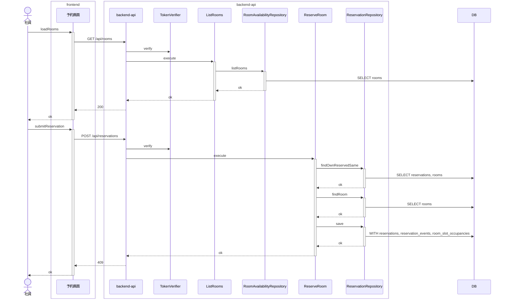
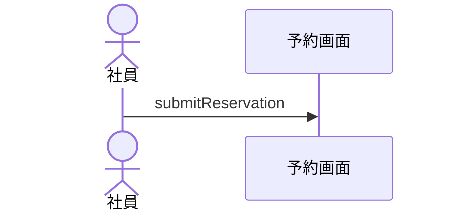
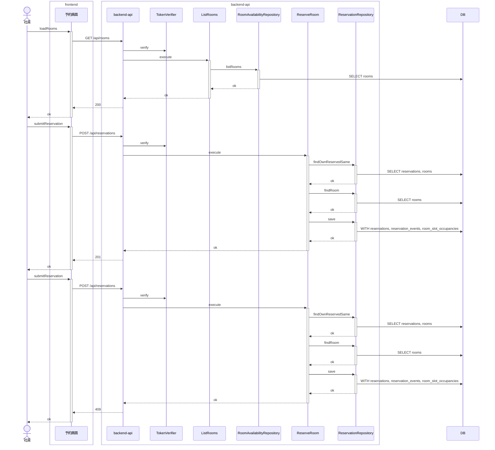
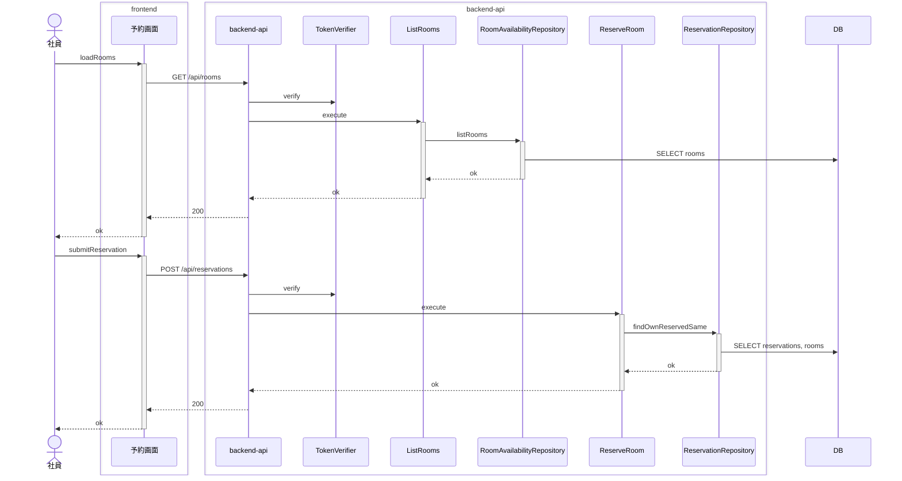
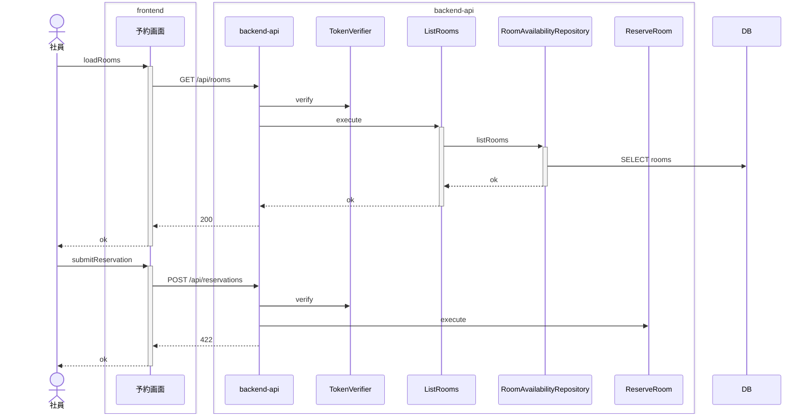
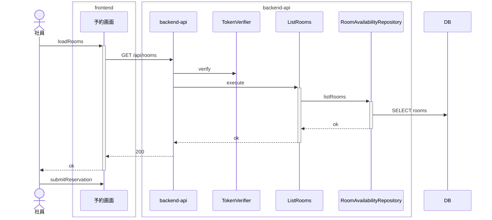

<!-- basis: requirements@64517f420b568ea1a4536b71b9dbbb357bd66460 adr@ed9e1fbd3b234cada613ca9357dd6e5ae36271e8 contracts@76f0dc8df238492dce1ee8c77458c1f3ce5fd586 | generated_at: 2026-11-10T06:12:49.207Z | slug: reserve-room -->

# 会議室予約 / 会議室を予約する — 全シナリオのシーケンス (抽出)

アクターは 社員。正常系は [index.md](index.md) の「どう動くか」にも載せている。

## 他の社員の予約とまったく同じ時間帯は送り直しとして扱わず予約できない



## 会議室を選ばずに予約すると、予約は送られず会議室を選ぶことが示される



## 別の会議室の同じ時間帯は予約できる


## 取り消された予約と同じ時間帯は予約できる


## 取り消した自分の予約と同じ内容でも、開始時刻を過ぎていれば過去の時間帯として予約できない


## 取り消した自分の予約と同じ内容で予約すると新しい予約が成立する


## 同時に予約されても成立するのは 1 件だけである



## 応答を受け取った後に自分の予約と同じ内容で送り直しても、重なりとして断られず成立済みの予約が示される



## 既存の予約と時間帯が一部重なる予約はできない


## 既存の予約の時間帯を含む予約はできない


## 既存の予約の終了時刻から始まる予約はできる


## 既存の予約の開始前から始まり一部重なる予約はできない


## 既存の予約の開始時刻に終わる予約はできる


## 日をまたぐ時間帯は予約できない



## 日付・開始時刻・終了時刻を選ばずに予約すると、予約は送られずそれぞれを選ぶことが示される



## 空いている会議室を予約すると予約が成立し、予約者が記録される


## 終了が翌日 0:00 の時間帯は予約できる


## 終了時刻が 30 分刻みでない時間帯は予約できない


## 終了時刻だけを選ばずに予約すると、予約は送られず終了時刻を選ぶことだけが示される


## 終了時刻を過ぎてから送り直しても過去の時間帯として断られず、成立済みの予約が示される


## 自分の予約と同じ内容で送り直すと、新しい予約は作られず成立済みの予約が示される

```mermaid
sequenceDiagram
    actor p0 as 社員
    box transparent frontend
        participant p1 as 予約画面
    end
    box transparent backend-api
        participant p2 as backend-api
        participant p3 as TokenVerifier
        participant p4 as ListRooms
        participant p5 as RoomAvailabilityRepository
        participant p7 as ReserveRoom
        participant p8 as ReservationRepository
    end
    participant p6 as DB
    p0->>+p1: loadRooms
    p1->>p2: GET /api/rooms
    p2->>p3: verify
    p2->>+p4: execute
    p4->>+p5: listRooms
    p5->>p6: SELECT rooms
    p5-->>-p4: ok
    p4-->>-p2: ok
    p2-->>p1: 200
    p1-->>-p0: ok
    p0->>+p1: submitReservation
    p1->>p2: POST /api/reservations
    p2->>p3: verify
    p2->>+p7: execute
    p7->>+p8: findOwnReservedSame
    p8->>p6: SELECT reservations, rooms
    p8-->>-p7: ok
    p7-->>-p2: ok
    p2-->>p1: 200
    p1-->>-p0: ok
```

## 自分の予約と時間帯が一部だけ重なる予約はできない

```mermaid
sequenceDiagram
    actor p0 as 社員
    box transparent frontend
        participant p1 as 予約画面
    end
    box transparent backend-api
        participant p2 as backend-api
        participant p3 as TokenVerifier
        participant p4 as ListRooms
        participant p5 as RoomAvailabilityRepository
        participant p7 as ReserveRoom
        participant p8 as ReservationRepository
    end
    participant p6 as DB
    p0->>+p1: loadRooms
    p1->>p2: GET /api/rooms
    p2->>p3: verify
    p2->>+p4: execute
    p4->>+p5: listRooms
    p5->>p6: SELECT rooms
    p5-->>-p4: ok
    p4-->>-p2: ok
    p2-->>p1: 200
    p1-->>-p0: ok
    p0->>+p1: submitReservation
    p1->>p2: POST /api/reservations
    p2->>p3: verify
    p2->>+p7: execute
    p7->>+p8: findOwnReservedSame
    p8->>p6: SELECT reservations, rooms
    p8-->>-p7: ok
    p7->>+p8: findRoom
    p8->>p6: SELECT rooms
    p8-->>-p7: ok
    p7->>+p8: save
    p8->>p6: WITH reservations, reservation_events, room_slot_occupancies
    p8-->>-p7: ok
    p7-->>-p2: ok
    p2-->>p1: 409
    p1-->>-p0: ok
```

## 過去の時間帯は予約できない

```mermaid
sequenceDiagram
    actor p0 as 社員
    box transparent frontend
        participant p1 as 予約画面
    end
    box transparent backend-api
        participant p2 as backend-api
        participant p3 as TokenVerifier
        participant p4 as ListRooms
        participant p5 as RoomAvailabilityRepository
        participant p7 as ReserveRoom
        participant p8 as ReservationRepository
    end
    participant p6 as DB
    p0->>+p1: loadRooms
    p1->>p2: GET /api/rooms
    p2->>p3: verify
    p2->>+p4: execute
    p4->>+p5: listRooms
    p5->>p6: SELECT rooms
    p5-->>-p4: ok
    p4-->>-p2: ok
    p2-->>p1: 200
    p1-->>-p0: ok
    p0->>+p1: submitReservation
    p1->>p2: POST /api/reservations
    p2->>p3: verify
    p2->>+p7: execute
    p7->>+p8: findOwnReservedSame
    p8->>p6: SELECT reservations, rooms
    p8-->>-p7: ok
    p7-->>-p2: ok
    p2-->>p1: 422
    p1-->>-p0: ok
```

## 開始時刻が 30 分刻みでない時間帯は予約できない

```mermaid
sequenceDiagram
    actor p0 as 社員
    box transparent frontend
        participant p1 as 予約画面
    end
    box transparent backend-api
        participant p2 as backend-api
        participant p3 as TokenVerifier
        participant p4 as ListRooms
        participant p5 as RoomAvailabilityRepository
        participant p7 as ReserveRoom
    end
    participant p6 as DB
    p0->>+p1: loadRooms
    p1->>p2: GET /api/rooms
    p2->>p3: verify
    p2->>+p4: execute
    p4->>+p5: listRooms
    p5->>p6: SELECT rooms
    p5-->>-p4: ok
    p4-->>-p2: ok
    p2-->>p1: 200
    p1-->>-p0: ok
    p0->>+p1: submitReservation
    p1->>p2: POST /api/reservations
    p2->>p3: verify
    p2->>p7: execute
    p2-->>p1: 422
    p1-->>-p0: ok
```

## 開始時刻が現在と同じ時間帯は予約できる

```mermaid
sequenceDiagram
    actor p0 as 社員
    box transparent frontend
        participant p1 as 予約画面
    end
    box transparent backend-api
        participant p2 as backend-api
        participant p3 as TokenVerifier
        participant p4 as ListRooms
        participant p5 as RoomAvailabilityRepository
        participant p7 as ReserveRoom
        participant p8 as ReservationRepository
    end
    participant p6 as DB
    p0->>+p1: loadRooms
    p1->>p2: GET /api/rooms
    p2->>p3: verify
    p2->>+p4: execute
    p4->>+p5: listRooms
    p5->>p6: SELECT rooms
    p5-->>-p4: ok
    p4-->>-p2: ok
    p2-->>p1: 200
    p1-->>-p0: ok
    p0->>+p1: submitReservation
    p1->>p2: POST /api/reservations
    p2->>p3: verify
    p2->>+p7: execute
    p7->>+p8: findOwnReservedSame
    p8->>p6: SELECT reservations, rooms
    p8-->>-p7: ok
    p7->>+p8: findRoom
    p8->>p6: SELECT rooms
    p8-->>-p7: ok
    p7->>+p8: save
    p8->>p6: WITH reservations, reservation_events, room_slot_occupancies
    p8-->>-p7: ok
    p7-->>-p2: ok
    p2-->>p1: 201
    p1-->>-p0: ok
```

## 開始時刻が終了時刻より後の時間帯は予約できない

```mermaid
sequenceDiagram
    actor p0 as 社員
    box transparent frontend
        participant p1 as 予約画面
    end
    box transparent backend-api
        participant p2 as backend-api
        participant p3 as TokenVerifier
        participant p4 as ListRooms
        participant p5 as RoomAvailabilityRepository
        participant p7 as ReserveRoom
    end
    participant p6 as DB
    p0->>+p1: loadRooms
    p1->>p2: GET /api/rooms
    p2->>p3: verify
    p2->>+p4: execute
    p4->>+p5: listRooms
    p5->>p6: SELECT rooms
    p5-->>-p4: ok
    p4-->>-p2: ok
    p2-->>p1: 200
    p1-->>-p0: ok
    p0->>+p1: submitReservation
    p1->>p2: POST /api/reservations
    p2->>p3: verify
    p2->>p7: execute
    p2-->>p1: 422
    p1-->>-p0: ok
```

## 開始時刻と終了時刻が同じ時間帯は予約できない

```mermaid
sequenceDiagram
    actor p0 as 社員
    box transparent frontend
        participant p1 as 予約画面
    end
    box transparent backend-api
        participant p2 as backend-api
        participant p3 as TokenVerifier
        participant p4 as ListRooms
        participant p5 as RoomAvailabilityRepository
        participant p7 as ReserveRoom
    end
    participant p6 as DB
    p0->>+p1: loadRooms
    p1->>p2: GET /api/rooms
    p2->>p3: verify
    p2->>+p4: execute
    p4->>+p5: listRooms
    p5->>p6: SELECT rooms
    p5-->>-p4: ok
    p4-->>-p2: ok
    p2-->>p1: 200
    p1-->>-p0: ok
    p0->>+p1: submitReservation
    p1->>p2: POST /api/reservations
    p2->>p3: verify
    p2->>p7: execute
    p2-->>p1: 422
    p1-->>-p0: ok
```

## 開始時刻を過ぎてから送り直しても過去の時間帯として断られず、成立済みの予約が示される

```mermaid
sequenceDiagram
    actor p0 as 社員
    box transparent frontend
        participant p1 as 予約画面
    end
    box transparent backend-api
        participant p2 as backend-api
        participant p3 as TokenVerifier
        participant p4 as ListRooms
        participant p5 as RoomAvailabilityRepository
        participant p7 as ReserveRoom
        participant p8 as ReservationRepository
    end
    participant p6 as DB
    p0->>+p1: loadRooms
    p1->>p2: GET /api/rooms
    p2->>p3: verify
    p2->>+p4: execute
    p4->>+p5: listRooms
    p5->>p6: SELECT rooms
    p5-->>-p4: ok
    p4-->>-p2: ok
    p2-->>p1: 200
    p1-->>-p0: ok
    p0->>+p1: submitReservation
    p1->>p2: POST /api/reservations
    p2->>p3: verify
    p2->>+p7: execute
    p7->>+p8: findOwnReservedSame
    p8->>p6: SELECT reservations, rooms
    p8-->>-p7: ok
    p7-->>-p2: ok
    p2-->>p1: 200
    p1-->>-p0: ok
```
