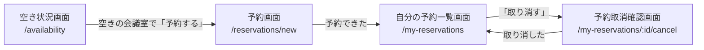

# 画面部品のレビュー要約

会議室予約システムの画面 4 枚について、見た目の決まり (色・文字・余白) と、画面を組み立てる部品を作りました。
見本は Storybook で確認でき、各画面の写真は `docs/design/screenshots/` にあります。

## 画面とやること

| 画面 | 社員がすること | 用意した状態の見本 |
|---|---|---|
| 空き状況画面 | 日付と時間帯を選び、5 部屋それぞれが「空き」か「予約済み」かを見る | 通常 / 読み込み中 / 時刻の前後が逆 / システムのエラー |
| 予約画面 | 会議室・日付・開始時刻・終了時刻を選んで予約する | 通常 / 送信中 / 予約できた / 時間帯が重なる / 過ぎた時刻 / 時刻の前後が逆 / 30 分刻みでない / システムのエラー |
| 自分の予約一覧画面 | 自分の有効な予約を見て、取り消す予約を選ぶ | 通常 / 予約が無い / 読み込み中 / 取り消した直後 / システムのエラー |
| 予約取消確認画面 | 予約の内容を確かめて取り消す | 通常 / 取り消し中 / 開始時刻を過ぎた / 既に取り消し済み / 本人の予約でない / 予約が無い / システムのエラー |

- 画面は上の 4 枚だけです (要求にある画面だけを作り、増やしていません)。
- 業務のエラーは、API が返すエラーのコードごとに決めた文 (例: 「この時間帯は既に予約されています」) を画面に出します。

## 部品

| 分類 | 部品 | 役割 |
|---|---|---|
| 共通 | Button / Badge / Card / Input / Select / Alert / Skeleton / Icon | ボタン・状態の札・枠・入力・選択・お知らせ・読み込み中の仮の枠・アイコン |
| 枠 | AppShell | 全画面の上部のヘッダー (ロゴ・「空き状況」「自分の予約」のメニュー・社員名) |
| 業務 | AvailabilityBadge | 「空き」「予約済み」を色・文字・アイコンの 3 つで示す |
| 業務 | ReservationStatusBadge | 予約の状態 (予約済み / 取消済み) |
| 業務 | TimeSlotPicker | 日付と、30 分刻みの開始・終了時刻 (0:00〜23:30。営業時間の制限なし) |
| 業務 | AvailabilitySearchForm | 空き状況を調べる入力と「空きを調べる」ボタン |
| 業務 | RoomAvailabilityList | 会議室ごとの空き状況の表。空きの部屋にだけ「予約する」を出す |
| 業務 | ReservationForm | 予約の入力 (会議室 + 日付と時間帯) |
| 業務 | ReservationSummary | 予約の要点 (会議室・日付・時間帯・状態) |
| 業務 | MyReservationList | 自分の有効な予約の表と「取り消す」ボタン。予約が無いときの案内 |
| 業務 | CancelConfirmPanel | 取り消しの確認。取り消せない理由があるときは取り消しボタンを出さない |
| 業務 | BusinessErrorAlert | エラーのコードに応じた理由の文を出す |

## 見た目の決まり

| 項目 | 決めたこと |
|---|---|
| 主な色 | 青 #1D4ED8 (主な操作)。「空き」は緑寄りの青 #0F766E、「予約済み」は灰、エラーは赤 |
| 文字 | Noto Sans JP。入っていない PC では OS の日本語ゴシックで表示する (外部からフォントを読み込まない) |
| 余白 | 画面の外周 1.5rem、まとまりの間 1.5rem、部品の間 0.75rem。情報が少ない画面なのでゆったりめ |
| レイアウト | 上部のヘッダーにメニュー (メニューが 2 つだけのため横のメニュー欄は使わない)。予約と取り消しの画面は中央寄せの 8/12 幅 |
| 端末 | PC のブラウザだけ (スマートフォン向けの切り替えは作らない) |
| 暗いテーマ | 用意した (全部の色に暗いテーマ用の値がある) |
| ロゴ | 会議室の扉と「空き」の印を組み合わせた形 (`src/assets/`) |

## ブランドの由来

- 由来: **推論 (inferred)**。会社のブランドの資料がこのリポジトリに無いため、要求から推論した色と文字 (決定記録 0008) をそのまま使いました。確信度は低いです。

## 確認してほしいこと

1. **色と文字**: 青 #1D4ED8 / 緑寄りの青 #0F766E / 橙 #F59E0B / 灰 #64748B と Noto Sans JP は推論の値です。会社で決まった色やフォントがあれば差し替えます (トークンの元の値を変えるだけで全画面に反映されます)。

## 目視の確認

- 手順の撮影 (captureStories.js) は **exit 2 で目視未実施** でした。この PC に Playwright 用のブラウザが入っていないためです (ビルドまでは通りました)。
- 代わりに、同じ撮り方 (同じ配信・同じ画面の大きさ 1280x800) を PC に入っている Chrome で行い、見本の全 76 件を撮って目で確認しました (`docs/design/screenshots/index.md`)。
- はみ出し・文字の切れ・読みにくい色の組み合わせは見つかりませんでした (明るいテーマで全件、暗いテーマで画面の見本を確認)。
