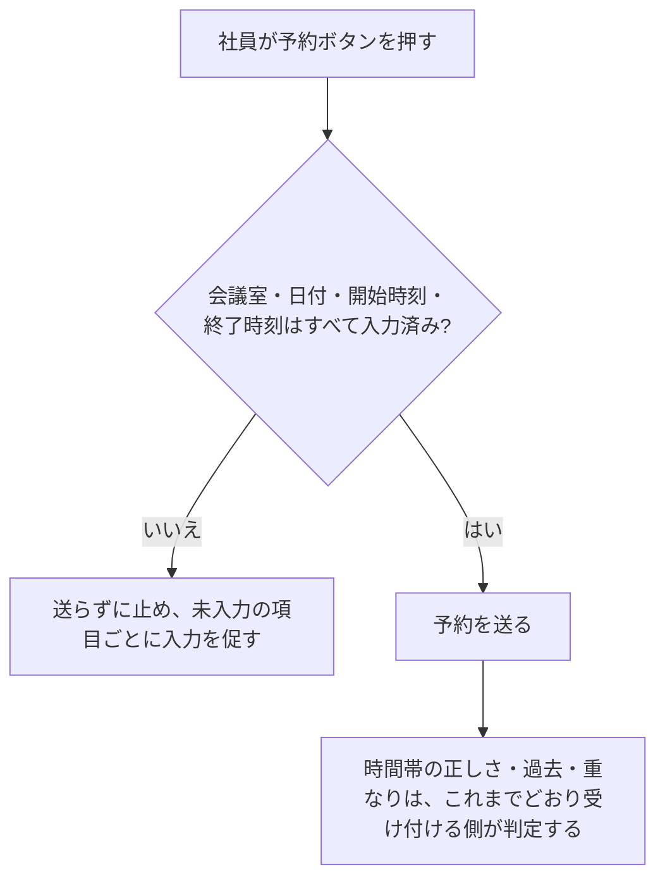
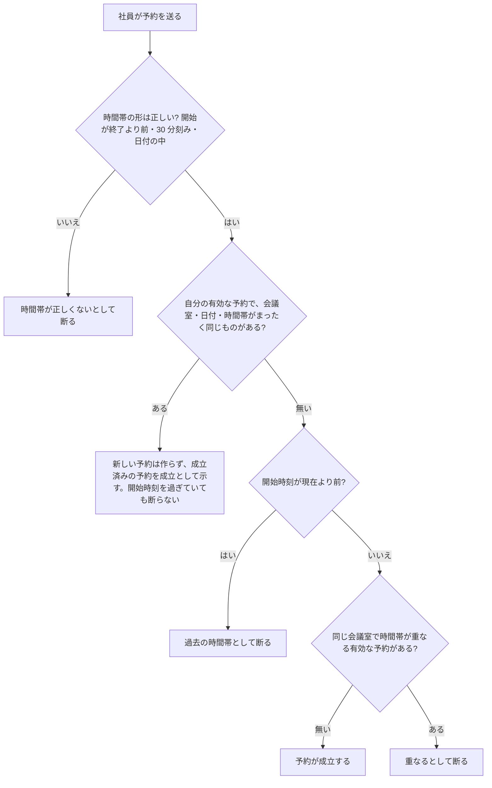
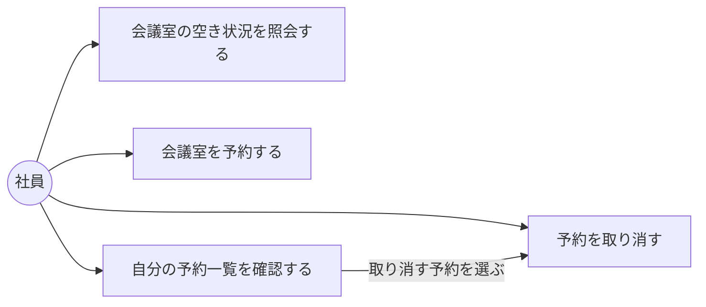
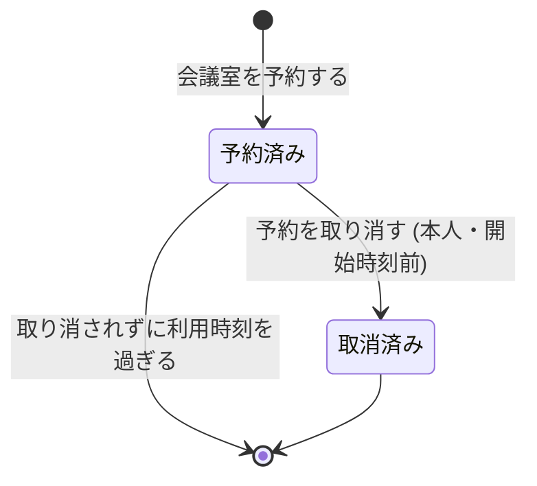

# 会議室予約システム 要求の確認材料

共有の表計算ファイルで起きている 3 つの問題 (二重に書き込まれる・空きが分かりにくい・取り消しが反映されない) を、Web 画面の予約の仕組みで解消する。

- 利用者: 社員 (会議室を予約する人)。数十人
- 会議室: 5 部屋 (会議室A〜会議室E。名前は仮置き)
- 外部のシステムとのつながり: 社内の認証基盤 (社員が社内の既存アカウントでログインし、システムが本人を識別する)

確認したい点があれば、引き継ぎファイルの問いにある。

## 今回の変更: 予約の入力が欠けているときは、画面で送らずに止める

予約の画面は、会議室や時刻が未入力のままでも予約を送っていた。未入力は「要求の形の誤り」として扱われ、業務の理由 (時間帯が正しくない・重なる など) を持たないので、社員には何を直せばよいかが伝わらない。

**決めた扱い (仮に決めた。差し戻せる)**: 課題には選択肢だけがあり、決定が無かった。次の案で反映した。

| 案 | 中身 | 採否 |
|---|---|---|
| 画面で止める | 会議室・日付・開始時刻・終了時刻のどれかが未入力なら、予約を送らず、未入力の項目ごとに「選んでください」と示す | **採用** |
| 今のまま送る | 送って、返ってきたエラーを画面に出す | 不採用 (未入力には業務の理由が無く、何を直すかが伝わらない) |

- 画面で先回りするのは「未入力」だけ。時間帯の正しさ・30 分刻み・過去・重なりの判定は画面に写さない (判定を 1 か所に保つ)
- 空き状況の照会の画面は今回変えていない (課題は予約の画面だけを対象にしていたため)

| 変えたこと | 内容 |
|---|---|
| 予約の仕様 | 未入力のときは画面で送らずに止めると書き足し、受入基準を 2 件足した (会議室が未入力 / 日付と時刻が未入力) |
| 条件「予約時刻の妥当性」 | 未入力の予約はこの判定に進まないと書き足した |
| 送り直しの仕様 (レビューの指摘で追加) | 予約の終了時刻を過ぎてから送り直しても断らず、成立済みの予約を示す受入基準を 1 件足した (仕様の中身は変えていない) |

同じ時期に届いたもう 1 件の課題 (同時の予約で重なったときのエラーを、どの層で作るか) は、開発のルールと実装の食い違いで、要求では直せない。要求は変えず、決定の段に戻した。

## 前回の変更: 応答が届かなかった予約を送り直しても「予約済み」と断らない

予約は成立したのに、通信の切断などで結果が画面に届かないことがある。社員が同じ内容で予約し直すと、自分の予約と重なるとして「予約済み」と断られていた。実際には自分の予約が成立しているので、社員は予約できていないと誤解する。

**決めた扱い (仮に決めた。差し戻せる)**: 課題には選択肢だけがあり、決定が無かった。次の案で反映した。

| 案 | 中身 | 採否 |
|---|---|---|
| 同じ内容の送り直しは成立済みの予約を返す | 自分の有効な予約と会議室・日付・開始時刻・終了時刻がすべて同じなら、新しい予約を作らず、成立済みの予約を「予約が成立した」として示す | **採用** |
| 今のまま断る | 「予約済み」と断り、自分の予約一覧で確かめてもらう | 不採用 (社員が誤解したまま) |

- 判定の順番 (レビューの指摘で追加。仮に決めた): 同じ内容の送り直しかどうかを、過去の時間帯かどうかより先に調べる。応答を受け取れなかった社員が予約の開始後に送り直しても「過去の時間帯」と断られず、予約が成立していると分かる
- 取り消した自分の予約と同じ内容を開始後に送ったときは、新しい予約として扱うので、過去の時間帯として断る

- 採用の理由: 画面を再読み込みしても効く (送るたびに付ける合言葉のような仕組みは、画面を開き直すと消える)。予約は増えないので二重予約の禁止とも両立する
- 一部だけ重なる自分の予約 (10:00-11:00 があるのに 10:30-11:30) は、これまでどおり断る
- 取り消した自分の予約と同じ内容なら、新しい予約として成立する
- 画面の「応答が届かなかった」ときの文言は変えていない。社員は同じ内容で予約し直せば、成立済みかどうかが分かる

| 変えたこと | 内容 |
|---|---|
| 予約の仕様 | 送り直しの扱いの仕様を 1 件足し、受入基準を 5 件書いた (うち 1 件は開始後の送り直し。レビューの指摘で追加)。重なりの仕様に「まったく同じ自分の予約の送り直しは断らない」を書き足した。予約時刻の仕様に「送り直しは過去の時間帯の判定より先に扱う」を書き足した |
| 条件「予約の重なり判定」「予約時刻の妥当性」 | 送り直しの例外と、過去の時間帯の判定より先に調べる順番を書き足した |
| 予約の UC の説明・情報「予約」 | 送り直しても予約が増えないことを書き足した |

## 前々回の変更: 会議室 5 部屋の名前と並び順を決めた (名前は仮置き)

要望には「会議室は 5 部屋」とだけあり、会議室の名前と、空き状況の一覧での並び順が決まっていなかった。実装は初期データに仮の名前を入れていた。

**決めた扱い**: これまでの確認で仮置きとした次の 5 部屋を要求に書いた。空き状況の一覧は、この表示順で並べる。

| 表示順 | 会議室名 | 会議室の識別子 |
|---|---|---|
| 1 | 会議室A | room-1 |
| 2 | 会議室B | room-2 |
| 3 | 会議室C | room-3 |
| 4 | 会議室D | room-4 |
| 5 | 会議室E | room-5 |

- 名前は**仮置き**。実際の会議室の名前は人しか知らないため、引き継ぎファイルの問いで確かめる
- 実際の名前が分かったら、この表と初期データを差し替える (契約の例と初期データは今の仮置きの値と同じ)

| 変えたこと | 内容 |
|---|---|
| 空き状況の照会の仕様 | 5 部屋の名前・識別子・表示順を書き、一覧は表示順に並べると書いた。受入基準を 1 件足した (会議室A〜E の順に並ぶ) |
| 情報「会議室」 | 項目に「表示順」を足し、説明に 5 部屋の名前と表示順を書いた |
| 照会の UC の説明 | 会議室を表示順に並べると書いた |
| 自分の予約一覧の仕様 (レビューの指摘で追加) | 一覧の各予約に会議室名・日付・開始時刻・終了時刻を出し、取り消す予約を見分けられると書いた。受入基準を 1 件足した (2 件の予約がそれぞれ会議室と日時で見分けられる) |

| 以前の変更 | 内容 |
|---|---|
| 時間帯は日をまたげない | 時間帯は指定した日付の中に収める。終了は翌日 0:00 (24:00) まで指定できる。23:00-翌 1:00 は照会も予約も受け付けない |
| 「空き」の意味 | 重なる有効な予約が無いことだけを示し、予約できることまでは示さない |

| 決まったこと (これまで) | 内容 |
|---|---|
| ログイン | 社内の既存アカウントでログインする |
| 会議室の登録 | 初期データとして入れる。登録の画面は作らない |
| 会議室の名前と並び順 | 会議室A〜会議室E を表示順 1〜5 で入れる (名前は仮置き) |
| 時刻の刻み | 30 分刻み |
| 過去の予約と時間帯 | 過去の時間帯は予約できない。営業時間などの制限は設けない |
| 取り消せる時期 | 開始時刻より前まで |
| 空き状況の表示 | 予約済みとだけ表示し、予約者の名前は出さない |

## UC 一覧

業務は「会議室予約」の 1 つ。

| 業務の流れ | UC | アクター | 一言説明 | 画面 |
|---|---|---|---|---|
| 会議室の空き状況を確認する | 会議室の空き状況を照会する | 社員 | 日付と時間帯を指定し、全会議室の空き / 予約済みを会議室ごとに見る | 空き状況画面 |
| 会議室を予約する | 会議室を予約する | 社員 | 会議室・日付・開始時刻・終了時刻を指定して予約する | 予約画面 |
| 予約を取り消す | 自分の予約一覧を確認する | 社員 | 自分の有効な予約を会議室名と日時つきで一覧で見る。取り消す予約を選ぶ入口 | 自分の予約一覧画面 |
| 予約を取り消す | 予約を取り消す | 社員 | 自分の予約を取り消す | 予約取消確認画面 |

「自分の予約一覧を確認する」は要望に明記されていない。取り消す予約を選ぶ入口として足した。

## 扱う情報

| 情報 | 持つ項目 |
|---|---|
| 会議室 | 会議室の識別子、会議室名、表示順 (空き状況の一覧で並べる順) |
| 予約 | 予約の識別子、会議室、日付、開始時刻、終了時刻、予約者 (社員)、予約の状態 |

## 業務ルール

| ルール | 内容 |
|---|---|
| 二重予約の禁止 | 同じ会議室で、時間帯が一部でも重なる有効な予約があれば予約できない |
| 重なりの判定 | 開始時刻を含み、終了時刻を含まない区間で比べる。10:00-11:00 の後の 11:00-12:00 は重ならない |
| 取り消した予約 | 空き状況でも重なりの判定でも、有効な予約として扱わない |
| 同時の予約 | 同じ会議室・同じ時間帯に同時に予約されても、成立するのは 1 件だけ |
| 送り直しの予約 | 社員が自分の有効な予約とまったく同じ会議室・日付・時間帯で予約し直すと、新しい予約は作らず、成立済みの予約を成立として示す。過去の時間帯かどうかより先に調べるので、開始後の送り直しも断らない |
| 未入力の予約 | 会議室・日付・開始時刻・終了時刻のどれかが未入力なら、画面で予約を送らずに止め、未入力の項目ごとに入力を促す。時間帯の正しさ・過去・重なりは画面で先回りせず、予約を受け付ける側で判定する (今回) |
| 時間帯の正しさ | 開始時刻は終了時刻より前でなければならない (予約と空き状況の照会の両方) |
| 時刻の刻み | 開始時刻と終了時刻は 30 分刻み (毎時 0 分か 30 分) で指定する (予約と空き状況の照会の両方) |
| 日をまたぐ時間帯 | 時間帯は指定した日付の中に収める。終了は翌日 0:00 (24:00) まで指定できる。23:00-翌 1:00 のような日をまたぐ指定は受け付けない (予約と空き状況の照会の両方) |
| 過去の予約 | 開始時刻が現在より前の予約はできない (自分の有効な予約とまったく同じ内容の送り直しは除く)。過去の時間帯の空き状況は見られる。営業時間などの時間帯の制限は設けない |
| 取り消せる人と時期 | 予約した本人だけが、開始時刻より前の有効な予約だけを取り消せる |
| 空き状況の区分 | 指定した時間帯に重なる有効な予約があれば「予約済み」、無ければ「空き」。「空き」は予約できることまでは示さない (予約できるかは予約のときに時間帯の正しさ・過去でないこと・重なりで判定する) |

## 状態遷移 (予約の状態)

## 受入基準

### 会議室の空き状況を照会する

- 5 部屋が登録されているとき、日付と時間帯を指定して表示すると、5 部屋すべてが会議室ごとに表示される
- 会議室A〜E が表示順 1〜5 で登録されているとき、空き状況を表示すると、会議室A・B・C・D・E の順に並ぶ
- 会議室 A の 10:00-11:00 に予約があるとき、同じ時間帯を表示すると、会議室 A は予約済み、予約の無い会議室は空きと表示される
- 会議室 A の 10:00-11:00 に社員 A の予約があるとき、社員 B が同じ時間帯を表示すると、会議室 A は予約済みとだけ表示され、社員 A の名前は表示されない
- 会議室 A の 10:00-11:00 に予約があるとき、11:00-12:00 を表示すると、会議室 A は空きと表示される
- 会議室 A の 10:00-11:00 の予約が取り消されているとき、同じ時間帯を表示すると、会議室 A は空きと表示される
- 開始 11:00・終了 10:00 で表示しようとすると、空き状況は表示されず、時間帯が正しくないことが示される
- 開始 10:00・終了 10:00 で表示しようとすると、空き状況は表示されず、時間帯が正しくないことが示される
- 開始 10:10・終了 11:00 で表示しようとすると、空き状況は表示されず、30 分刻みで指定することが示される
- 会議室 A の 23:30-翌日 0:00 に予約があるとき、開始 23:30・終了 翌日 0:00 (24:00) で表示すると、照会は受け付けられ、会議室 A は予約済み、予約の無い会議室は空きと表示される
- 開始 23:00・終了 翌日 1:00 で表示しようとすると、空き状況は表示されず、時間帯が正しくないことが示される
- 現在が 12:00 のとき、同じ日の 10:00-11:00 を表示すると、照会は受け付けられ、会議室ごとの空き / 予約済みが表示される

### 会議室を予約する

予約が成立する基準は、現在を予約の日の前日 (2026-11-09 12:00) に固定して確かめる。実行する日によって結果が変わらないようにするため。

- 予約が無い時間帯を社員 A が予約すると、予約が成立し、予約者として社員 A が記録される
- 開始 11:00・終了 10:00 で予約すると、予約は成立せず、時間帯が正しくないことが示される
- 開始 10:00・終了 10:00 で予約すると、予約は成立せず、時間帯が正しくないことが示される
- 開始 10:10 で予約すると、予約は成立せず、30 分刻みで指定することが示される
- 予約が無い 23:30-翌日 0:00 (24:00) を予約すると、予約が成立する
- 開始 23:00・終了 翌日 1:00 で予約すると、予約は成立せず、時間帯が正しくないことが示される
- 現在が 12:00 のとき、同じ日の 10:00-11:00 を予約すると、成立せず、過去の時間帯は予約できないことが示される
- 会議室 A の 10:00-11:00 に予約があるとき、社員 B が 10:30-11:30 を予約すると、成立せず、既存の予約と重なることが示される
- 会議室 A の 10:00-11:00 に予約があるとき、社員 B が 11:00-12:00 を予約すると、成立する
- 会議室 A の 10:00-11:00 に予約があるとき、社員 B が会議室 B の 10:00-11:00 を予約すると、成立する
- 会議室 A の 10:00-11:00 の予約が取り消されているとき、社員 B が同じ時間帯を予約すると、成立する
- 社員 A と社員 B が同時に同じ会議室・同じ時間帯を予約すると、成立するのは 1 件だけで、もう一方には重なることが示される
- 社員 A の会議室 A 10:00-11:00 の予約が成立したが結果が届かなかったとき、社員 A が同じ内容でもう一度予約すると、新しい予約は作られず、予約が成立していることが示され、社員 A の有効な予約は 1 件のまま
- 会議室 A の 10:00-11:00 に社員 A の予約があるとき、社員 A が 10:30-11:30 を予約すると、成立せず、既存の予約と重なることが示される
- 会議室 A の 10:00-11:00 に社員 A の予約があるとき、社員 B が同じ 10:00-11:00 を予約すると、成立せず、既存の予約と重なることが示される
- 社員 A の会議室 A 10:00-11:00 の予約が取り消されているとき、社員 A が同じ内容で予約すると、新しい予約が成立する
- 現在が 10:30 (開始後) で、社員 A の会議室 A 10:00-11:00 の予約が成立したが結果が届かなかったとき、社員 A が同じ内容でもう一度予約すると、過去の時間帯として断られず、予約が成立していることが示され、有効な予約は 1 件のまま (レビューの指摘で追加)
- 現在が 11:30 (終了後) で、社員 A の会議室 A 10:00-11:00 の予約が成立したが結果が届かなかったとき、社員 A が同じ内容でもう一度予約すると、過去の時間帯として断られず、予約が成立していることが示され、有効な予約は 1 件のまま (今回のレビューの指摘で追加)
- 時間帯を選んだが会議室を選ばずに予約すると、予約は送られず成立せず、会議室を選ぶことが示される (今回)
- 会議室を選んだが日付・開始時刻・終了時刻を選ばずに予約すると、予約は送られず成立せず、日付・開始時刻・終了時刻をそれぞれ選ぶことが示される (今回)

### 自分の予約一覧を確認する

- 社員 A の予約が 2 件、社員 B の予約が 1 件あるとき、社員 A が一覧を表示すると、社員 A の 2 件だけが表示される
- 社員 A が会議室 A の 11/10 10:00-11:00 と会議室 B の 11/11 14:00-15:00 を予約しているとき、一覧を表示すると、2 件がそれぞれ会議室名と日時で見分けられるように表示される
- 社員 A の予約のうち 1 件が取り消されているとき、一覧を表示すると、取り消された予約は表示されない

### 予約を取り消す

取り消しを受け付けない基準は、確かめたい理由以外では取り消せる状況にして確かめる (例: 本人以外の基準は現在を開始時刻の 1 時間前に固定する)。別の理由で拒否されて基準を満たしてしまうのを防ぐため。

- 現在が開始時刻の 1 時間前のとき、社員 A が自分の予約を取り消すと、予約は取消済みになり、有効な予約ではなくなる
- 現在が開始時刻の 1 時間前のとき、社員 B が社員 A の予約を取り消そうとすると、受け付けられず、本人の予約ではないため取り消せないことが示され、予約は有効なまま残る
- 現在が開始時刻の 1 時間前のとき、取り消し済みの予約をもう一度取り消そうとすると、受け付けられず、すでに取り消された予約であることが示される
- 現在が開始時刻を 30 分過ぎているとき、社員 A が自分の予約を取り消そうとすると、受け付けられず、開始時刻を過ぎた予約は取り消せないことが示される
- 現在が開始時刻ちょうどのとき、社員 A が自分の予約を取り消そうとすると、受け付けられず、開始時刻を迎えた予約は取り消せないことが示され、予約は有効なまま残る

## RDRA の整合性

参照の不整合と未接続の要素は 0 件。
