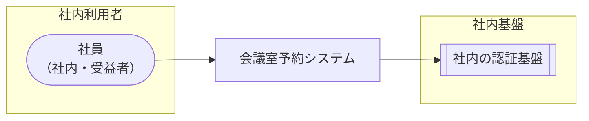

<!-- generateRdraMd.js による自動生成ファイル。手動編集しないこと。元データ: docs/requirements/rdra/*.tsv -->

# システムコンテキスト

RDRA システム価値レイヤー。システムに関わるアクターと外部システムの全体像。

> 凡例: `(丸角)` アクター / `[四角]` システム / `[[二重枠]]` 外部システム

## アクター

| アクター群 | アクター | 役割 | 社内外 | 立場 | 主担当業務 |
|---|---|---|---|---|---|
| 社内利用者 | 社員 | 日付と時間帯を指定して会議室の空き状況を確認し、空いている会議室を予約する。自分が予約した有効な予約の一覧を確認し、開始時刻より前に取り消す | 社内 | 受益者 | 会議室予約 |

## 外部システム

| 外部システム群 | 外部システム | 役割 |
|---|---|---|
| 社内基盤 | 社内の認証基盤 | 社員が社内の既存アカウントでログインし、システムに本人 (予約者) を識別させる |
