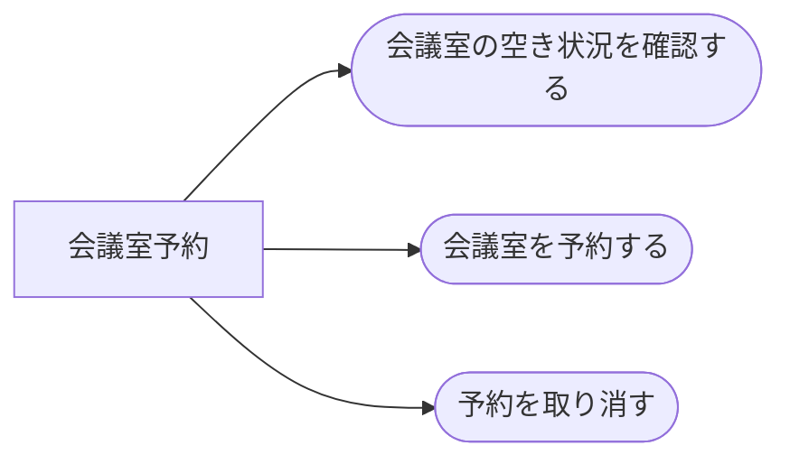

<!-- generateRdraMd.js による自動生成ファイル。手動編集しないこと。元データ: docs/requirements/rdra/*.tsv -->

# 業務構成

RDRA システム外部環境レイヤー。業務とビジネスユースケース（BUC）の構成。

> 凡例: `[四角]` 業務 / `(丸角)` BUC

## BUC 一覧

| 業務 | BUC | アクティビティ数 | UC 数 |
|---|---|---|---|
| 会議室予約 | 会議室の空き状況を確認する | 1 | 1 |
| 会議室予約 | 会議室を予約する | 1 | 1 |
| 会議室予約 | 予約を取り消す | 2 | 2 |
