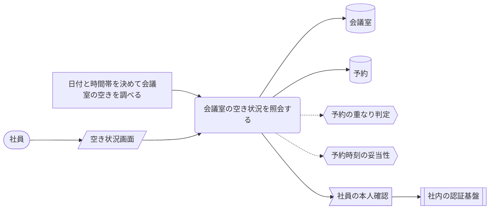
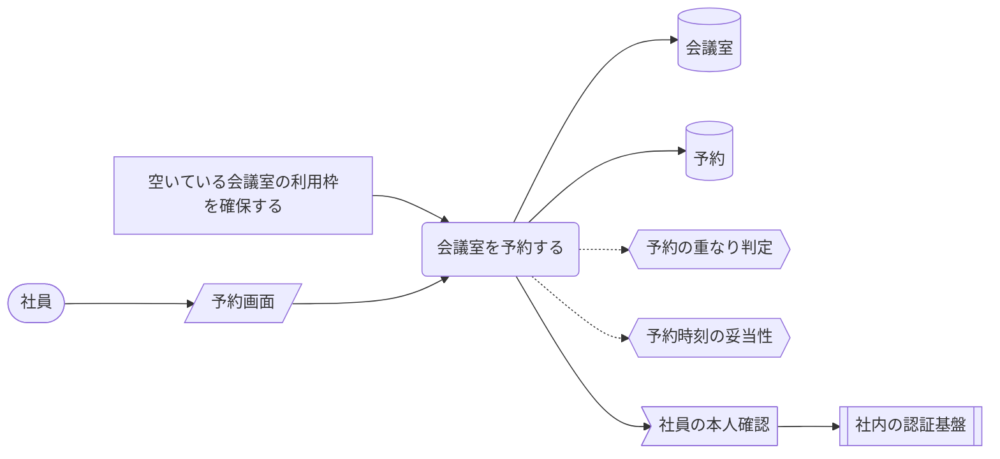
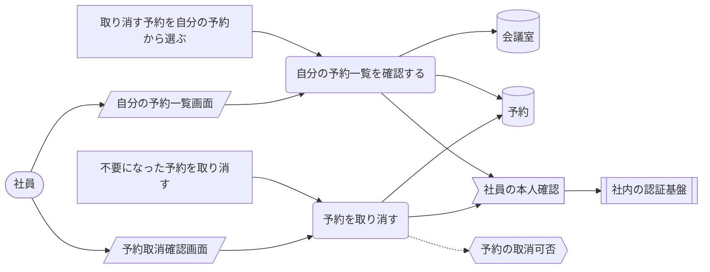

<!-- generateRdraMd.js による自動生成ファイル。手動編集しないこと。元データ: docs/requirements/rdra/*.tsv -->

# UC複合図

RDRA システム境界レイヤー。BUC ごとに、アクティビティ・UC・画面・イベント・
情報・条件・外部システムの関係を表す。

## 会議室予約

### 会議室の空き状況を確認する

> 凡例: `(丸角)` アクター・UC / `[四角]` アクティビティ / `[/斜め/]` 画面 / `[(円柱)]` 情報 / `{{六角}}` 条件 / `>旗]` イベント / `[[二重枠]]` 外部システム。点線は条件参照。

| UC | アクティビティ | 画面 | 情報 | 条件 | イベント | 説明 |
|---|---|---|---|---|---|---|
| 会議室の空き状況を照会する | 日付と時間帯を決めて会議室の空きを調べる | 空き状況画面 | 会議室、予約 | 予約の重なり判定、予約時刻の妥当性 | 社員の本人確認 | 社員が日付と時間帯を指定し、全会議室についてその時間帯が空きか予約済みかを会議室ごとに一覧で表示する。会議室は会議室名を表示順の昇順に並べる。予約済みの会議室には予約済みとだけ表示し、予約者の名前は表示しない。取消済みの予約は予約済みとして扱わない。時間帯の重なりは開始を含み終了を含まない区間で判定する。開始時刻が終了時刻より前でない場合、時刻が 30 分刻みでない場合と、時間帯が指定した日付の中に収まらない (終了は翌日 0:00 まで可) 場合は照会を受け付けない。過去の時間帯の照会は受け付ける。空きは重なる有効な予約が無いことを示し、予約できることまでは示さない (過去の時間帯は空きでも予約できない) |

### 会議室を予約する

> 凡例: `(丸角)` アクター・UC / `[四角]` アクティビティ / `[/斜め/]` 画面 / `[(円柱)]` 情報 / `{{六角}}` 条件 / `>旗]` イベント / `[[二重枠]]` 外部システム。点線は条件参照。

| UC | アクティビティ | 画面 | 情報 | 条件 | イベント | 説明 |
|---|---|---|---|---|---|---|
| 会議室を予約する | 空いている会議室の利用枠を確保する | 予約画面 | 会議室、予約 | 予約の重なり判定、予約時刻の妥当性 | 社員の本人確認 | 社員が会議室・日付・開始時刻・終了時刻を指定して予約し、予約者として社員を記録する。予約が成立すると予約状態が予約済みになる。開始時刻が終了時刻より前でない場合、時刻が 30 分刻みでない場合、時間帯が指定した日付の中に収まらない (終了は翌日 0:00 まで可) 場合、開始時刻が現在より前の場合と、同じ会議室で時間帯が重なる有効な予約がある場合は受け付けない。同時に予約されても成立するのは 1 件だけにする。応答が届かず社員が自分の有効な予約と同じ会議室・日付・時間帯でもう一度予約したときは、新しい予約を作らず、成立済みのその予約を成立した結果として示す。この送り直しは開始時刻が現在より前かどうかより先に判定し、開始時刻を過ぎた後の送り直しも過去の時間帯として断らない |

### 予約を取り消す

> 凡例: `(丸角)` アクター・UC / `[四角]` アクティビティ / `[/斜め/]` 画面 / `[(円柱)]` 情報 / `{{六角}}` 条件 / `>旗]` イベント / `[[二重枠]]` 外部システム。点線は条件参照。

| UC | アクティビティ | 画面 | 情報 | 条件 | イベント | 説明 |
|---|---|---|---|---|---|---|
| 自分の予約一覧を確認する | 取り消す予約を自分の予約から選ぶ | 自分の予約一覧画面 | 会議室、予約 |  | 社員の本人確認 | 社員が自分が予約した有効な予約の一覧を表示する。取り消す予約を選ぶ入口になる。一覧の各予約には会議室名・日付・開始時刻・終了時刻を表示し、取り消す予約を見分けられるようにする。他の社員の予約と取消済みの予約は表示しない |
| 予約を取り消す | 不要になった予約を取り消す | 予約取消確認画面 | 予約 | 予約の取消可否 | 社員の本人確認 | 予約した本人が、開始時刻より前の予約済みの予約を取り消す。取り消した予約は予約状態が取消済みになり、空き状況の表示と重なりの判定から外れる。本人以外、取消済み、開始時刻を過ぎた予約の取り消しは受け付けない |
