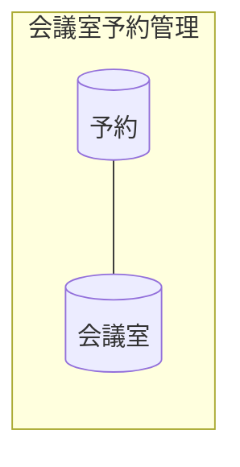

<!-- generateRdraMd.js による自動生成ファイル。手動編集しないこと。元データ: docs/requirements/rdra/*.tsv -->

# 情報モデル

RDRA システム内部レイヤー。コンテキストごとの情報と情報間の関連。

> 凡例: `[(円柱)]` 情報 / `[四角]` 情報.tsv 未定義の参照。実線は関連情報。

## 情報一覧

| コンテキスト | 情報 | 属性 | 状態モデル | バリエーション | 説明 |
|---|---|---|---|---|---|
| 会議室予約管理 | 会議室 | 会議室ID、会議室名、表示順 |  | 空き状況 | 予約の対象となる社内の会議室 (5 部屋)。会議室A〜会議室E (会議室ID room-1〜room-5、表示順 1〜5。名前は実際の会議室名が分かるまでの仮置き) を初期データで登録し、空き状況の一覧は表示順の昇順に並べる。空き状況 (空き / 予約済み) を会議室ごとに示し、予約の重なりを判定する単位になる |
| 会議室予約管理 | 予約 | 予約ID、会議室、日付、開始時刻、終了時刻、予約者、予約状態 | 予約状態 |  | 社員が会議室を利用する時間帯を確保した記録。時間帯は日付の中に収まり、終了時刻は翌日 0:00 (24:00) まで取りうる。予約者 (予約した社員) を記録し、予約状態 (予約済み / 取消済み) を保持する。同じ社員が自分の有効な予約と同じ会議室・日付・時間帯で予約し直しても、予約は増えない (成立済みの予約を返す)。空き状況の表示、重なりの判定、自分の予約一覧の表示、取り消しの対象になる |
