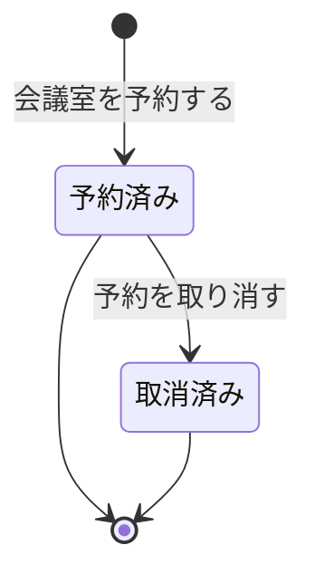

<!-- generateRdraMd.js による自動生成ファイル。手動編集しないこと。元データ: docs/requirements/rdra/*.tsv -->

# 状態モデル

RDRA システム内部レイヤー。状態モデルごとの状態遷移。遷移ラベルは UC。

## 予約状態（会議室予約管理）

| 状態 | 遷移UC | 遷移先状態 | 説明 |
|---|---|---|---|
|  | 会議室を予約する | 予約済み | 「会議室を予約する」で予約が成立すると予約済みになる。予約済みの予約は有効な予約として空き状況の表示と重なりの判定に含める |
| 予約済み | 予約を取り消す | 取消済み | 「予約を取り消す」で予約した本人が開始時刻より前に取り消すと取消済みになる。取消済みの予約は有効な予約として扱わず、空き状況の表示と重なりの判定から外す |
| 予約済み |  |  | 取り消されないまま開始時刻を過ぎた予約は予約済みのまま終わる。開始時刻を過ぎた予約は取り消せない |
| 取消済み |  |  | 取消済みの予約はそれ以上遷移しない。再度の取り消しは受け付けない |
