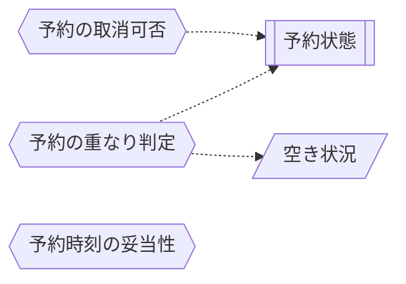

<!-- generateRdraMd.js による自動生成ファイル。手動編集しないこと。元データ: docs/requirements/rdra/*.tsv -->

# 条件・バリエーション

RDRA システム内部レイヤー。判断条件（ビジネスルール）と区分・種別の一覧。

## 条件（ビジネスルール）

> 凡例: `{{六角}}` 条件 / `[[二重枠]]` 状態モデル / `[/斜め/]` バリエーション

| コンテキスト | 条件 | 条件の説明 | バリエーション | 状態モデル |
|---|---|---|---|---|
| 会議室予約管理 | 予約の重なり判定 | 同じ会議室で時間帯が重なる有効な予約 (予約済み) があれば予約を受け付けない。 → 細目: [条件: 予約の重なり判定](#条件-予約の重なり判定) | 空き状況 | 予約状態 |
| 会議室予約管理 | 予約の取消可否 | 本人の予約済みの予約を、開始時刻より前にだけ取り消せる。 → 細目: [条件: 予約の取消可否](#条件-予約の取消可否) |  | 予約状態 |
| 会議室予約管理 | 予約時刻の妥当性 | 時間帯の形が正しく、開始時刻が過去でない予約だけを受け付ける。 → 細目: [条件: 予約時刻の妥当性](#条件-予約時刻の妥当性) |  |  |

### 条件: 予約の重なり判定

同じ会議室で時間帯が重なる有効な予約 (予約済み) があれば予約を受け付けない。

- 時間帯は開始を含み、終了を含まない
- 終了時刻と次の開始時刻が同じ予約は重ならない
- 取消済みの予約は数えない
- 同時に予約されても成立するのは 1 件だけにする
- 例外: 自分の有効な予約と会議室・日付・開始時刻・終了時刻がすべて同じ予約は送り直しとみなし、新しい予約を作らず成立済みの予約を示す
- 時間帯が一部だけ重なる自分の予約は、重なりとして受け付けない
- 取消済みの自分の予約と同じ内容は、新しい予約として扱う
- 順番: 送り直しの判定は「予約時刻の妥当性」の過去の時刻の検査より先に行う
- 送り直しは開始時刻 (終了時刻) を過ぎていても成立済みの予約を示す
- 空き状況の表示では、重なる有効な予約があれば予約済み、無ければ空きとする

### 条件: 予約の取消可否

本人の予約済みの予約を、開始時刻より前にだけ取り消せる。

- 予約者本人であること
- 現在が開始時刻より前であること
- 予約状態が予約済みであること
- いずれかを満たさなければ取り消しを受け付けない

### 条件: 予約時刻の妥当性

時間帯の形が正しく、開始時刻が過去でない予約だけを受け付ける。

- 開始時刻が終了時刻より前であること
- 開始時刻と終了時刻が 30 分刻み (毎時 0 分か 30 分) であること
- 開始時刻と終了時刻が指定した日付の中に収まること (終了は翌日 0:00 まで可。日をまたぐ時間帯は不可)
- 開始時刻が現在より前でないこと
- いずれかを満たさなければ予約を受け付けない
- 時間帯の形の検査 (前後・30 分刻み・日付の中) は空き状況の照会にも使い、満たさなければ照会を受け付けない
- 過去の時刻の検査は予約だけに使い、過去の時間帯の照会は受け付ける
- 例外: 自分の有効な予約と会議室・日付・開始時刻・終了時刻がすべて同じ送り直しは、過去の時間帯として断らない
- 順番: 送り直しの判定を、過去の時刻の検査より先に「予約の重なり判定」で行う
- 利用できる時間帯 (営業時間) の制限は設けない
- 会議室・日付・開始時刻・終了時刻のどれかが未入力のときは、画面で予約を送らずに止めて項目ごとに入力を促し、この条件の判定には進まない

## バリエーション

| コンテキスト | バリエーション | 値 | 説明 |
|---|---|---|---|
| 会議室予約管理 | 空き状況 | 空き、予約済み | 会議室ごとに、指定した時間帯に重なる有効な予約があるかを示す区分。 → 細目: [バリエーション: 空き状況](#バリエーション-空き状況) |

### バリエーション: 空き状況

会議室ごとに、指定した時間帯に重なる有効な予約があるかを示す区分。

- 重なる有効な予約 (予約済み) があれば予約済み、無ければ空きとする
- 取消済みの予約は予約済みとして扱わない
- 空きは予約できることまでは示さない
- 予約できるかは、条件「予約時刻の妥当性」と「予約の重なり判定」で予約のときに別に判定する
- このため過去の時間帯は空きと表示されても予約できない
